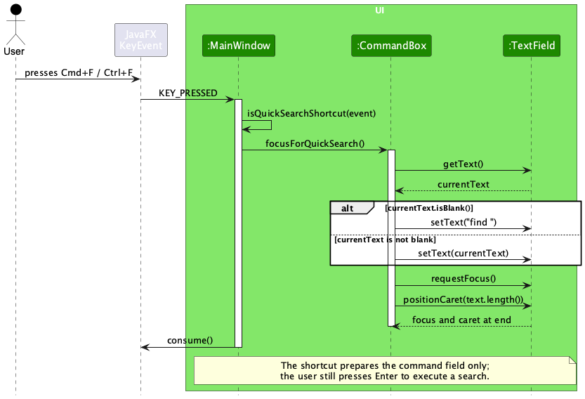
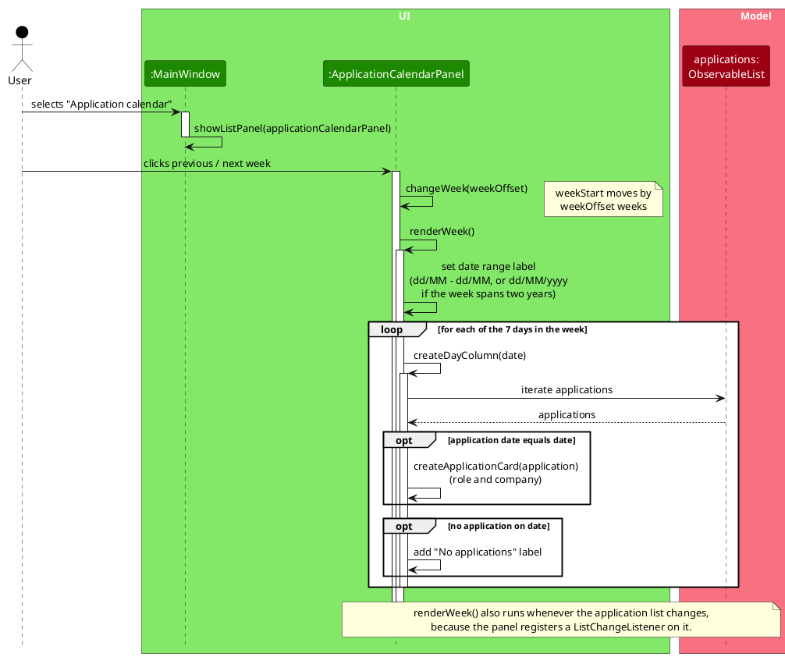
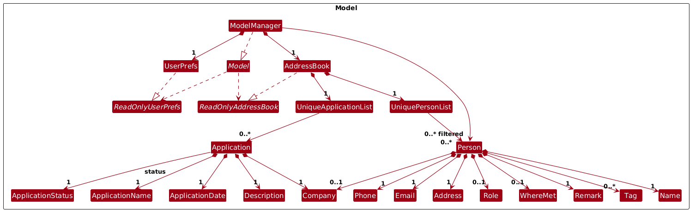
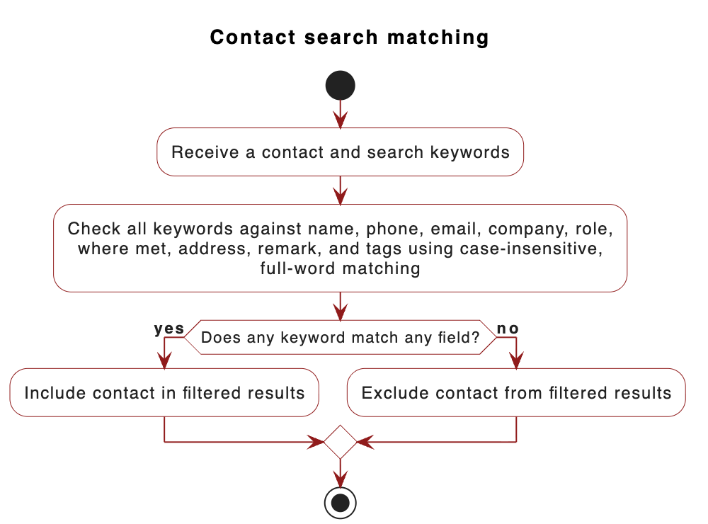
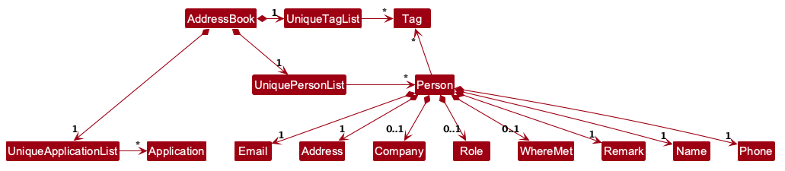
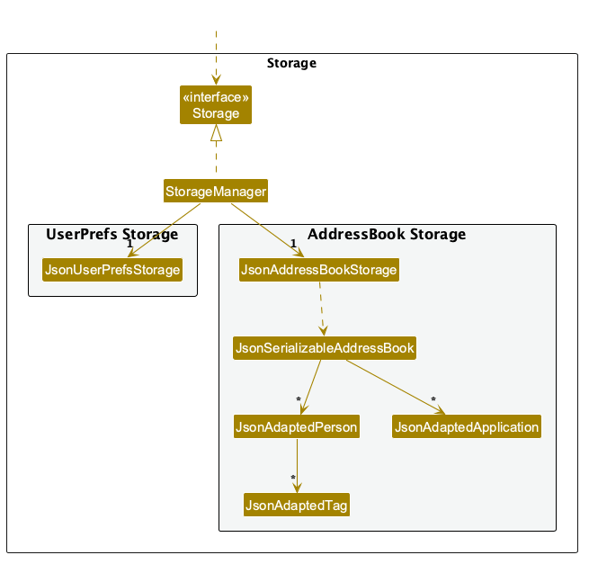

* Table of Contents
{:toc}

--------------------------------------------------------------------------------------------------------------------

## **Acknowledgements**

* In v1.5, mao455 used [OpenAI Codex](https://openai.com/codex/) to investigate alpha-test defects, prepare fixes for contact view switching and remark prefix validation, add regression tests, and update the User Guide and Developer Guide.

--------------------------------------------------------------------------------------------------------------------

## **Setting up, getting started**

Set up JDK `25` according to the [course's Java setup requirements](https://nus-cs2103-ay2627-s1.github.io/website/admin/programmingLanguages.html).
**Mac users:** Follow the [course-recommended Mac installation guide](https://se-education.org/guides/tutorials/javaInstallationMac.html)
and use the exact Azul JDK + JavaFX distribution it specifies. Having another Java `25` installation is not sufficient.

For project setup and IDE configuration, refer to [_Setting up and getting started_](SettingUp.md).

For releases, run `./gradlew shadowJar` to build `build/libs/addressbook.jar`.
Verify the release JAR using the course-required JDK: run `java -version` in the terminal you will use,
then launch the JAR from an empty, writable test folder with `java -jar "addressbook.jar"`.

--------------------------------------------------------------------------------------------------------------------

## **Design**

<div markdown="span" class="alert alert-primary">

:bulb: **Tip:** The `.puml` files used to create diagrams are in `docs/diagrams`. Refer to the [_PlantUML Tutorial_ at se-edu/guides](https://se-education.org/guides/tutorials/plantUml.html) to learn how to create and edit diagrams.
</div>

### Architecture


The ***Architecture Diagram*** given above explains the high-level design of the App.

The following provides a quick overview of the main components and their interactions.

**Main components of the architecture**

**`Main`** (consisting of classes [`Main`](https://github.com/AY2627S1-CS2103T-T12-3/tp/blob/master/src/main/java/seedu/address/Main.java) and [`MainApp`](https://github.com/AY2627S1-CS2103T-T12-3/tp/blob/master/src/main/java/seedu/address/MainApp.java)) is in charge of the app launch and shut down.
* At app launch, it initializes the other components in the correct sequence, and connects them up with each other.
* At shut down, it shuts down the other components and invokes cleanup methods where necessary.

The bulk of the app's work is done by the following four components:

* [**`UI`**](#ui-component): The UI of the App.
* [**`Logic`**](#logic-component): The command executor.
* [**`Model`**](#model-component): Holds the data of the App in memory.
* [**`Storage`**](#storage-component): Reads data from, and writes data to, the hard disk.

[**`Commons`**](#common-classes) represents a collection of classes used by multiple other components.

**How the architecture components interact with each other**

The *Sequence Diagram* below shows how the components interact with each other for the scenario where the user issues the command `delete 1`.


Each of the four main components (also shown in the diagram above),

* defines its *API* in an `interface` with the same name as the Component.
* provides its functionality through a concrete `{Component Name}Manager` class that implements the corresponding API interface.

For example, the `Logic` component defines its API in `Logic.java` and implements it in `LogicManager.java`. Other components interact with a component through its interface rather than its concrete class, preventing them from coupling to that component's implementation, as illustrated in the following partial class diagram.


The sections below give more details of each component.

### UI component

The **API** of this component is specified in [`Ui.java`](https://github.com/AY2627S1-CS2103T-T12-3/tp/blob/master/src/main/java/seedu/address/ui/Ui.java)


The UI consists of a `MainWindow` and its parts, such as `CommandBox`, `ResultDisplay`, `PersonListPanel`, and `StatusBarFooter`. All of these, including `MainWindow`, inherit from the abstract `UiPart` class, which captures common behavior among classes that represent visible GUI parts.

The `UI` component uses the JavaFX UI framework. The layouts of these UI parts are defined in matching `.fxml` files in `src/main/resources/view`. For example, [`MainWindow.fxml`](https://github.com/AY2627S1-CS2103T-T12-3/tp/blob/master/src/main/resources/view/MainWindow.fxml) specifies the layout of [`MainWindow`](https://github.com/AY2627S1-CS2103T-T12-3/tp/blob/master/src/main/java/seedu/address/ui/MainWindow.java).

The sequence diagram below shows how the Cmd+F (macOS) or Ctrl+F (Windows/Linux) shortcut prepares the command field for a contact search. If the field is empty or contains only whitespace, `find ` is inserted; otherwise, the current text is preserved. The command field receives focus and the caret moves to the end. The shortcut does not execute the search; the user presses Enter to run the command.



The `UI` component,

* executes user commands using the `Logic` component.
* listens for changes to `Model` data so that the UI can be updated with the modified data.
* keeps a reference to the `Logic` component, because the `UI` relies on the `Logic` to execute commands.
* depends on some classes in the `Model` component because it displays `Person` objects from the model.

The weekly application calendar is an `ApplicationCalendarPanel` that `MainWindow` displays when the user selects **Calendar** in the sidebar. The panel keeps the Monday that starts the selected week and redraws the header range and seven day columns whenever the user moves to the previous or next week. Each column lists the applications whose application date falls on that day, showing the role and company, or a placeholder if there are none. The range omits the year unless the week spans two years. The sequence diagram below shows this flow.



### Logic component

**API** : [`Logic.java`](https://github.com/AY2627S1-CS2103T-T12-3/tp/blob/master/src/main/java/seedu/address/logic/Logic.java)

Here's a (partial) class diagram of the `Logic` component:


The sequence diagram below illustrates the interactions within the `Logic` component, taking `execute("delete 1")` API call as an example.


<div markdown="span" class="alert alert-info">:information_source: **Note:** The lifeline for `DeleteCommandParser` should end at the destroy marker (X), but due to a limitation of PlantUML, it continues to the end of the diagram.
</div>

How the `Logic` component works:

1. When `Logic` is called upon to execute a command, the command is passed to an `AddressBookParser` object, which in turn creates a parser that matches the command (e.g., `DeleteCommandParser`) and uses it to parse the command.
1. This results in a `Command` object (more precisely, an object of one of its subclasses e.g., `DeleteCommand`) which is executed by the `LogicManager`.
1. The command can communicate with the `Model` when it is executed (e.g. to delete a person).<br>
   Note that although this is shown as a single step in the diagram above for simplicity, the code can require several interactions between the command object and the `Model` to complete the operation.
1. The result of the command execution is encapsulated as a `CommandResult` object which is returned from `Logic`.

Here are the other classes in `Logic` (omitted from the class diagram above) that are used for parsing a user command:


How the parsing works:
* When called upon to parse a user command, the `AddressBookParser` class creates an `XYZCommandParser` (`XYZ` is a placeholder for the specific command name, e.g., `AddCommandParser`). The parser uses the other classes shown above to parse the user command and create an `XYZCommand` object (e.g., `AddCommand`). The `AddressBookParser` returns that object as a `Command` object.
* All `XYZCommandParser` classes, such as `AddCommandParser` and `DeleteCommandParser`, implement the `Parser` interface so they can be treated similarly where appropriate, for example during testing.

### Model component
**API** : [`Model.java`](https://github.com/AY2627S1-CS2103T-T12-3/tp/blob/master/src/main/java/seedu/address/model/Model.java)




The `Model` component,

* stores the address book data i.e., all `Person` objects (which are contained in a `UniquePersonList` object) and all `Application` objects (which are contained in a `UniqueApplicationList` object).
* stores the `Person` objects selected by the current filter, such as search results, in a separate _filtered_ list. It exposes this list as an unmodifiable `ObservableList<Person>` that the UI can observe and bind to, so the UI updates when the list changes.
* stores a `UserPrefs` object that represents the user’s preferences (currently, just the GUI settings). This is exposed to the outside as a `ReadOnlyUserPrefs` object.
* does not depend on any of the other three components (as the `Model` represents data entities of the domain, they should make sense on their own without depending on other components)

Contact search updates the filtered list using `ContactContainsKeywordsPredicate`. It checks each keyword against every supplied contact field and keeps a contact if any field contains a case-insensitive, full-word match. Empty optional company, role, and where-met values and absent addresses are skipped. The `Person` model tracks whether an address is absent; older data without this flag treats the legacy `Not provided` value as absent. An explicitly supplied address with that value remains searchable. `FindCommand` includes its normalized search terms in `CommandResult`, and the contact panel keeps a `Filtered by` indicator visible while the predicate remains active. `EditCommand` replaces the person without resetting the filtered list's predicate, so the filter is reapplied to the updated person and the indicator remains visible. Commands that reset the contact filter clear the indicator. The activity diagram summarizes the matching logic.



<div markdown="span" class="alert alert-info">:information_source: **Note:** The alternative, arguably more object-oriented, design below keeps a unique list of tags in `AddressBook`, and each `Person` references tags from that list. This lets `AddressBook` maintain one `Tag` object per unique tag instead of each `Person` holding its own `Tag` objects.<br>



</div>


### Storage component

**API** : [`Storage.java`](https://github.com/AY2627S1-CS2103T-T12-3/tp/blob/master/src/main/java/seedu/address/storage/Storage.java)



The `Storage` component,
* can save both address book data and user preference data in JSON format, and read them back into corresponding objects.
* is implemented by `StorageManager`, which delegates the actual JSON file access to `JsonAddressBookStorage` and `JsonUserPrefsStorage` (one class per data file).
* depends on some classes in the `Model` component (because the `Storage` component's job is to save/retrieve objects that belong to the `Model`)

### Common classes

Classes used by multiple components are in the `seedu.address.commons` package.

--------------------------------------------------------------------------------------------------------------------

## **Implementation**

This section describes some noteworthy details on how certain features are implemented.

### \[Proposed\] Undo/redo feature

#### Proposed Implementation

The proposed undo/redo mechanism is facilitated by `VersionedAddressBook`. It extends `AddressBook` with an undo/redo history, stored internally as an `addressBookStateList` and `currentStatePointer`. Additionally, it implements the following operations:

* `VersionedAddressBook#commit()` — Saves the current address book state in its history.
* `VersionedAddressBook#undo()` — Restores the previous address book state from its history.
* `VersionedAddressBook#redo()` — Restores a previously undone address book state from its history.

These operations are exposed in the `Model` interface as `Model#commitAddressBook()`, `Model#undoAddressBook()` and `Model#redoAddressBook()` respectively.

Given below is an example usage scenario and how the undo/redo mechanism behaves at each step.

Step 1. The user launches the application for the first time. The `VersionedAddressBook` will be initialized with the initial address book state, and the `currentStatePointer` pointing to that single address book state.


Step 2. The user executes `delete 5` command to delete the 5th person in the address book. The `delete` command calls `Model#commitAddressBook()`, causing the modified state of the address book after the `delete 5` command executes to be saved in the `addressBookStateList`, and the `currentStatePointer` is shifted to the newly inserted address book state.


Step 3. The user executes `add n/David …​` to add a new person. The `add` command also calls `Model#commitAddressBook()`, causing another modified address book state to be saved into the `addressBookStateList`.


<div markdown="span" class="alert alert-info">:information_source: **Note:** If a command fails its execution, it will not call `Model#commitAddressBook()`, so the address book state will not be saved into the `addressBookStateList`.

</div>

Step 4. The user now decides that adding the person was a mistake, and decides to undo that action by executing the `undo` command. The `undo` command will call `Model#undoAddressBook()`, which will shift the `currentStatePointer` once to the left, pointing it to the previous address book state, and restores the address book to that state.


<div markdown="span" class="alert alert-info">:information_source: **Note:** If the `currentStatePointer` is at index 0, pointing to the initial AddressBook state, then there are no previous AddressBook states to restore. The `undo` command uses `Model#canUndoAddressBook()` to check if this is the case. If so, it will return an error to the user rather
than attempting to perform the undo.

</div>

The following sequence diagram shows how an undo operation goes through the `Logic` component:


<div markdown="span" class="alert alert-info">:information_source: **Note:** The lifeline for `UndoCommand` should end at the destroy marker (X), but due to a limitation of PlantUML, it continues to the end of the diagram.

</div>

Similarly, how an undo operation goes through the `Model` component is shown below:


The `redo` command does the opposite — it calls `Model#redoAddressBook()`, which shifts the `currentStatePointer` once to the right, pointing to the previously undone state, and restores the address book to that state.

<div markdown="span" class="alert alert-info">:information_source: **Note:** If the `currentStatePointer` is at index `addressBookStateList.size() - 1`, pointing to the latest address book state, then there are no undone AddressBook states to restore. The `redo` command uses `Model#canRedoAddressBook()` to check if this is the case. If so, it will return an error to the user rather than attempting to perform the redo.

</div>

Step 5. The user then decides to execute the command `list`. Commands that do not modify the address book, such as `list`, will usually not call `Model#commitAddressBook()`, `Model#undoAddressBook()` or `Model#redoAddressBook()`. Thus, the `addressBookStateList` remains unchanged.


Step 6. The user executes `clear`, which calls `Model#commitAddressBook()`. Since the `currentStatePointer` is not pointing at the end of the `addressBookStateList`, all address book states after the `currentStatePointer` will be purged. Reason: It no longer makes sense to redo the `add n/David …​` command. This is the behavior that most modern desktop applications follow.


The following activity diagram summarizes what happens when a user executes a new command:


#### Design considerations:

**Aspect: How undo & redo execute:**

* **Alternative 1 (current choice):** Saves the entire address book.
  * Pros: Easy to implement.
  * Cons: May have performance issues in terms of memory usage.

* **Alternative 2:** Individual command knows how to undo/redo by
  itself.
  * Pros: Will use less memory (e.g. for `delete`, just save the person being deleted).
  * Cons: We must ensure that the implementation of each individual command is correct.

_{more aspects and alternatives to be added}_

--------------------------------------------------------------------------------------------------------------------

## **Documentation, logging, testing, dev-ops**

* [Documentation guide](Documentation.md)
* [Testing guide](Testing.md)
* [Logging guide](Logging.md)
* [DevOps guide](DevOps.md)

--------------------------------------------------------------------------------------------------------------------

## **Appendix: Requirements**

### Product scope

**Target user profile**:

* is a university Computing student applying for multiple internships or graduate roles
* needs to keep application details and job-search contacts, such as recruiters, alumni, and referrers, together
* wants to find and update these records quickly while preparing applications and interviews
* prefers a desktop app and is comfortable using keyboard-driven CLI commands

**Value proposition**: InternTrack provides one keyboard-driven desktop workspace for recording internship and
graduate role applications alongside the professional contacts who can support a student's job search.


### User stories

Priorities: High (must have) - `* * *`, Medium (nice to have) - `* *`, Low (unlikely to have) - `*`

| Priority | As a …​  | I want to …​                                      | So that I can…​                                      |
| -------- | -------- | ------------------------------------------------- | ---------------------------------------------------- |
| `* * *`  | new user | see usage instructions                            | learn or recall how to use InternTrack               |
| `* * *`  | student  | add a professional contact                        | keep details of people relevant to my job search     |
| `* * *`  | student  | list my professional contacts                     | review my professional connections                   |
| `* * *`  | student  | search contacts by any field                      | retrieve relevant contact details quickly             |
| `* * *`  | student  | add an internship or graduate role application    | track each opportunity I apply for                    |
| `* * *`  | student  | list my internship and graduate role applications | review the opportunities I am pursuing               |
| `* *`    | student  | edit a professional contact                       | keep the contact's details accurate                   |
| `* *`    | student  | edit an application                               | keep its details current as my application progresses |
| `* *`    | student  | delete a professional contact or application      | remove a record that I no longer need                 |
| `* *`    | student  | record where I met a contact                       | remember how the contact is connected to my search   |

### Use cases

(For all use cases below, the **System** is `InternTrack` and the **Actor** is the `user`, unless specified otherwise)

**Use case: Add an internship or graduate role application**

**MSS**

1.  User enters the `addapp` command with the role, company, description, and application date.
2.  InternTrack checks that all required details are present and valid.
3.  InternTrack checks that an application with the same role and company does not already exist.
4.  InternTrack stores the application record.
5.  InternTrack confirms that the application was added.

    Use case ends.

**Extensions**

* 2a. A required application detail is missing or invalid.

    * 2a1. InternTrack shows an error message and does not save the application.

      Use case resumes at step 1.

* 3a. An application with the same role and company already exists.

    * 3a1. InternTrack informs the user that the application is a duplicate and does not save it.

      Use case ends.

**Use case: Edit a professional contact**

**MSS**

1.  User requests to list professional contacts.
2.  InternTrack shows the current list of professional contacts.
3.  User requests to edit a contact in the list, providing the details to update.
4.  InternTrack validates the updated contact details.
5.  InternTrack updates the professional contact.
6.  InternTrack confirms that the contact was updated.

    Use case ends.

**Extensions**

* 2a. The contact list is empty.

  Use case ends.

* 3a. The given contact index is invalid.

    * 3a1. InternTrack shows an error message.

      Use case resumes at step 2.

* 4a. An updated contact detail is invalid.

    * 4a1. InternTrack shows an error message.

      Use case resumes at step 3.

**Use case: Find a professional contact**

**MSS**

1.  User enters the `find` command with one or more keywords.
2.  InternTrack searches all contact fields using case-insensitive, full-word matching.
3.  InternTrack shows the contacts where any keyword matches any field.

    Use case ends.

**Extensions**

* 2a. No contact matches the supplied keywords.

    * 2a1. InternTrack shows that there are no matching contacts.

      Use case ends.

* 1a. The user does not supply any search keywords.

    * 1a1. InternTrack shows the command format.

      Use case ends.

### Non-Functional Requirements

1.  Should work on a _mainstream OS_ with Java `25` configured according to the course's Java setup requirements.
    macOS users must use the prescribed Azul JDK + JavaFX distribution.
2.  Should be able to hold up to 1000 professional contacts and application records without noticeable sluggishness
    during typical usage.
3.  A user with above average typing speed for regular English text should be able to add, edit, delete, and list
    records faster using commands than using the mouse.
4.  Contact and application records should remain available after the application is closed and reopened.
5.  The app should not require an internet connection for users to create, find, edit, or remove their local records.

### Glossary

* **Mainstream OS**: Windows, Linux, Unix, or macOS
* **Application record**: A record of an internship or graduate role application, including its role, company,
  description, and application date
* **Professional contact**: A person relevant to the user's internship or graduate-job search, such as a recruiter,
  interviewer, alumnus, or referrer
* **Application date**: The calendar date on which the user submitted an application, stored in `YYYY-MM-DD` format
* **Where met**: A short note describing how or where the user first met a professional contact
* **CLI**: Command Line Interface, a text-based interface through which users interact with InternTrack by typing
  commands

--------------------------------------------------------------------------------------------------------------------

## **Appendix: Instructions for Manual Testing**

This appendix provides a reproducible route through InternTrack's user-testable features, with representative valid
and invalid inputs. Run the sections in order unless a section states otherwise. Enter each command separately.
For command syntax and field constraints, refer to the [User Guide](UserGuide.md); explore additional variations
beyond the cases below.

### Test setup, launch and help

1. Follow [Quick start](UserGuide.md#quick-start) to configure the course-required JDK, including the prescribed
   Azul JDK + JavaFX distribution on macOS. Download `addressbook.jar` into a **new, empty, writable test folder**,
   separate from your real InternTrack data. In a terminal, change to this folder, run `java -version` to verify
   the active JDK, then launch with `java -jar "addressbook.jar"`
   (substitute the actual downloaded filename if it differs).<br>
   **Expected:** Overview opens with six sample contacts and no applications. `preferences.json` is created in
   the test folder. The app must not load records from your normal home folder.
2. Enter `help`, close the help window, then open it again using the top-right **Help** button and, separately,
   **F1**. Select **Copy URL** and paste into a browser.<br>
   **Expected:** Each method opens or focuses the help window. The copied URL points to the InternTrack User Guide;
   loading the website requires internet access. Close Help before continuing.
3. Enter `clear`, followed by `list` and `listapp`.<br>
   **Expected:** Both lists are empty, with messages suggesting `add` and `addapp` respectively. No confirmation
   prompt appears. **Use `clear` only in the disposable test folder.**

### Contacts: creation, fields and duplicate detection

1. Enter the following commands, one at a time:

   ```text
   add n/Ada Tester c/Example Labs r/Recruiter e/ada@example.com p/+65 9123-4567 w/Career Fair
   add n/Ben Tester c/Other Labs r/Engineer e/ben@example.com p/92345678
   list
   ```

   **Expected:** Contacts opens with two contacts: Ada at index `1` and Ben at index `2`. Ada's stored phone is
   `+6591234567` and where-met detail is `Career Fair`. Ben has no where-met detail. Both contacts start with
   address `Not provided`, no tags and no remark. The list message reports two contacts.
2. Enter `add n/ADA TESTER c/Third Labs r/Manager e/ADA@example.com p/93456789`.<br>
   **Expected:** A duplicate-contact error. There are still two contacts; Ada's existing details are unchanged.
3. Enter `add n/Missing Email c/Example Labs r/Recruiter p/94567890`.<br>
   **Expected:** A missing-required-field error. No contact is created. The failed input remains available to correct.

### Contacts: editing, tags, remarks and search

1. Enter `edit 1 c/Updated Labs r/Hiring Manager a/NUS Computing w/LinkedIn t/recruiter t/alumni`.<br>
   **Expected:** Ada's company, role, address and where-met detail are replaced, with tags `recruiter` and `alumni`.
   Name, email and phone are unchanged. The full Contacts list is shown.
2. Enter `edit 1 t/referrer`, then `edit 1 w/ t/`.<br>
   **Expected:** The first command replaces both old tags with `referrer`. The second removes the where-met detail
   and all tags. Neither command changes Ada's other fields.
3. Enter `edit 1 p/123`, then `edit 2 n/Ada Tester e/ada@example.com`.<br>
   **Expected:** The first command reports an invalid phone; the second reports a duplicate contact. Neither changes
   the saved contacts. `list` still shows Ada and Ben with their previous details.
4. Enter `find Ada`, then `remark 1 r/Met at university fair`.<br>
   **Expected:** Ada receives that remark, while her role remains `Hiring Manager`. The full Contacts list is restored
   and the search indicator disappears.
5. Enter `find Ada`, then `remark 1 r/first r/second`.<br>
   **Expected:** The repeated prefix is rejected; Ada's remark remains `Met at university fair`.
6. Enter `remark 1 r/`, then `find Ada`.<br>
   **Expected:** Ada's remark is removed and hidden on the card. The search returns Ada only, with
   `Filtered by: Ada` displayed above the results.
7. Select **Applications**, then **Contacts** in the sidebar.<br>
   **Expected:** The contact filter and indicator remain in effect. Switching pages does not clear them.
8. Enter `find UPDATED engineer`.<br>
   **Expected:** Both contacts appear: Ada matches her company and Ben matches his role. Matching is case-insensitive
   and uses OR across keywords and contact fields.
9. Enter `find Ad`, then `find nobodymatchesmanualtest`, then `list`.<br>
   **Expected:** Each search produces an empty list, because `Ad` is not the full word `Ada` and the other keyword
   matches no field. `list` restores both contacts and removes the filter indicator.

### Applications: creation, fields, status and validation

1. Enter these commands separately:

   ```text
   addapp n/QA Intern c/Example Labs d/Applied online dt/2026-10-28
   addapp n/Graduate Engineer c/Other Labs d/Alumni referral dt/2026-10-29 s/interviewing
   listapp
   ```

   **Expected:** Applications shows two indexed cards. QA Intern is index `1`, with date `2026-10-28` and status
   Applied; Graduate Engineer is index `2`, with date `2026-10-29` and status Interviewing. Each card shows its name,
   company, description, date and status, with different status colours. The message reports two applications.
2. Enter `addapp n/qa intern c/EXAMPLE LABS d/Different description dt/2026-11-01`.<br>
   **Expected:** A duplicate-application error despite the different description and date. Two applications remain.
3. Enter `addapp n/Invalid Date c/Example Labs d/Date validation dt/2026-02-30`, then
   `editapp 1 s/PENDING`.<br>
   **Expected:** The invalid calendar date and unsupported status are rejected. No record is created or changed.
4. Enter `editapp 1 n/QA Engineer Intern c/Updated Labs d/Interview arranged dt/2026-10-30 s/OFFERED`.<br>
   **Expected:** All supplied fields change on the first card, which stays at index `1`. The second application
   remains unchanged. Its company is independent of any contact's company.
5. Enter `editapp 2 n/QA Engineer Intern c/Updated Labs`, then `editapp 1`.<br>
   **Expected:** The duplicate application edit and the edit with no fields are rejected; both cards retain their
   previous values.
6. Enter `list`, then `editapp 2 d/Prepare interview notes`.<br>
   **Expected:** The command edits Graduate Engineer, even though Contacts was open, and switches to Applications.
   Its other fields and both contacts remain unchanged.

### Overview and sidebar quick commands

Prerequisite: The two contacts and two applications above remain in the test data; application statuses are Offered
and Interviewing.

1. Select **Overview**.<br>
   **Expected:** Active applications is `2` and Interviewing is `1`. The application table shows both applications.
   Contact cards appear in reverse Contacts order (Ben before Ada). Scroll as needed to inspect the content.
   Use Contacts list indexes, rather than Overview numbers, for contact commands.
2. Type `draft input` in the command box, then select the sidebar **addapp** quick command. Repeat with **add**.<br>
   **Expected:** Each button replaces the draft with its command word and a trailing space, focuses the box and
   positions the caret at the end. No record is added until a complete command is submitted. The current view stays open.
3. Empty the box and select the **find** quick command. Then replace its text with `list` and select **find** again.<br>
   **Expected:** The empty box becomes `find `; the non-empty `list` text is preserved. Both actions focus the command
   box without running a command. Clear the draft before continuing.

### Weekly application calendar

1. Select **Calendar**. Use the arrows to reach **26/10 – 01/11**, the week starting 26 October 2026.<br>
   **Expected:** All seven days, Monday through Sunday, remain visible. Graduate Engineer appears on Thursday
   29 October and QA Engineer Intern on Friday 30 October. Empty days show `No applications`. Cards show name,
   company and status; these dates represent application dates, not interview appointments.
2. Enter `editapp 1 dt/2026-10-31 s/REJECTED` while Calendar is open.<br>
   **Expected:** Calendar stays open on the same week. QA Engineer Intern moves from Friday to Saturday and shows
   REJECTED. Graduate Engineer is unchanged.
3. Enter `addapp n/Calendar Tester c/Calendar Labs d/Manual calendar check dt/2026-10-28 s/WITHDRAWN`.<br>
   **Expected:** Calendar stays open and adds Calendar Tester to Wednesday. This is application index `3` in the
   Applications list; calendar cards do not provide the indexes for application commands.
4. Enter `deleteapp 3` while Calendar is open.<br>
   **Expected:** The Wednesday card disappears without leaving the current week. The other two applications remain.
5. Navigate forward one week, then back; navigate to the week starting 28 December 2026; finally select **Today**.<br>
   **Expected:** The arrows change the displayed week. The first week without test applications has no application
   cards. The year-crossing range shows `28/12/2026 – 03/01/2027`. Today returns to the computer's current week and
   highlights today's column; test applications appear only if their dates fall within that week.
6. Select **Overview**.<br>
   **Expected:** Active applications is now `1` and Interviewing is `1`: Rejected is excluded from the active count.
   The Withdrawn application was deleted. Use the sidebar to return to either list.

### Keyboard search and command history

1. Clear the command box. Press **Cmd+F** on macOS or **Ctrl+F** on Windows/Linux, type `Ada` after the prepared
   `find ` and press Enter.<br>
   **Expected:** The shortcut focuses the box and inserts `find `; submitting the command opens Contacts with only Ada.
2. Type `list` without submitting and press the same shortcut.<br>
   **Expected:** The existing text is preserved and the caret moves to its end. Press Enter to restore both contacts.
3. Enter `listapp`, then `notacommand`. Replace the rejected input with `unfinished draft` without submitting it.
   Press Up twice, then Down twice.<br>
   **Expected:** Up recalls `notacommand`, then `listapp`; Down returns to `notacommand`, then restores
   `unfinished draft`. Invalid commands are included in history. Clear the draft before continuing.

### Saving, shutdown, backup and recovery

Prerequisite: Two contacts and two applications remain. Ada has no where-met detail, tags or remark. QA Engineer
Intern has date `2026-10-31` and status Rejected; Graduate Engineer is Interviewing.

1. Resize and reposition the main window, enter `exit`, then relaunch the same JAR from the same test folder.<br>
   **Expected:** The app closes and reopens; window size and position are retained. `list` and `listapp` show the
   same records and edited values. A new app session does not retain the previous command history.
2. Close the app using the window's close button. Copy `data/addressbook.json` to a backup outside the test
   folder, then relaunch and enter `clear`.<br>
   **Expected:** Window-close shutdown works; `clear` empties both lists immediately. Exit again, replace
   `data/addressbook.json` with the backup and relaunch.<br>
   **Expected after restore:** Both contacts and both applications return with their saved values. Follow the
   [UG backup instructions](UserGuide.md#backing-up-and-restoring-data) when transferring the file to another computer.
3. Optional save-failure test: with the app closed and a backup preserved, make the test data file or folder
   non-writable using your OS's file permissions. Relaunch and run
   `addapp n/Permission Test c/Test Labs d/Should not save dt/2026-10-29`.<br>
   **Expected, if the OS denies the write:** A save-permission error is shown and the new application is rolled back;
   `listapp` still contains only the previous two records. Restore write permissions before continuing. This test
   is not meaningful if your OS account can override the permissions.
4. Optional invalid-file recovery test: close the app, preserve the valid backup and replace the contents of the
   test `data/addressbook.json` with `not valid JSON`. Relaunch.<br>
   **Expected:** Both lists start empty; the invalid file is not immediately replaced by a read-only `list` or
   `listapp`. Close the app and restore the valid backup before continuing. Do not run a record-changing command
   until you have preserved any data you need.

### Deletion, invalid indexes and final cleanup

Prerequisite: Restore the valid backup from the preceding section, if needed, so there are two contacts and two
applications. The following commands intentionally remove test records.

1. Enter `list`, then `delete 0`; enter `listapp`, then `deleteapp 99` and `deleteapp 1 2`.<br>
   **Expected:** Each invalid command reports an error without deleting any record. The last command rejects
   multiple indexes rather than deleting either application.
2. Enter `find Ben`, then `delete 1`.<br>
   **Expected:** Only Ben is deleted. Contacts opens with no matching results and the Ben filter remains active.
   Enter `list`: Ada is now index `1`. Both applications remain.
3. Enter `listapp`, then `deleteapp 2`, then `deleteapp 1`, then `listapp`.<br>
   **Expected:** Graduate Engineer is removed first and QA Engineer Intern remains at index `1`; after deleting it,
   the list is empty and suggests `addapp`. Ada remains in Contacts.
4. Enter `clear`, then `list` and `listapp`, then `exit`.<br>
   **Expected:** All remaining test records are removed, both lists are empty and the app exits. Relaunching from
   this test folder keeps the saved empty lists rather than recreating the sample contacts.
