* Table of Contents
{:toc}

--------------------------------------------------------------------------------------------------------------------

## **Acknowledgements**

* Based on [AddressBook-Level3](https://se-education.org/addressbook-level3/) by the [SE-EDU initiative](https://se-education.org).
* Libraries used: [JavaFX](https://openjfx.io/), [Jackson](https://github.com/FasterXML/jackson), [JUnit5](https://github.com/junit-team/junit5).
* The weekly application calendar view takes its inspiration from the timetable view of [NUSMods](https://nusmods.com/), whose clean weekly layout we admired and adapted for tracking application dates. No NUSMods code was reused.
* **Use of AI tools:** Our team used AI assistants as pair-programming and review partners, mainly OpenAI Codex and also Claude Code. Every design decision, requirement and merge was made by us, and each member read, tested and edited what they committed. Individuals are responsible for the correctness of their own contributions. Notable uses of AI:
  * **Investigating and fixing bugs:** we reproduced defects in the released JARs ourselves, then used AI to help trace the cause through the parser and UI code and to propose fixes. For example, the contact view switching and duplicate `r/` prefix fixes (PR #120) and the null-tag and null-entry recovery in saved data. We checked each fix against regression tests that failed before the change.
  * **Writing and extending tests:** AI helped suggest edge cases for parsers, validation and storage, which we then reviewed and kept or discarded. Tests were run with `./gradlew clean test checkstyleMain checkstyleTest` before merging.
  * **Reviewing code:** AI was used as a second reviewer to spot style, checkstyle and code quality issues (for example static import order and parsing clean-up) before teammates reviewed the PR.
  * **Documentation and diagrams:** AI helped us proofread the UG and DG, align them with the current behaviour of the product, and update PlantUML diagrams (model, storage, UI and calendar sequence diagrams) to match the code.
  * **Team workflow:** we wrote a shared `tp-project-work` skill (`.agents/skills/`) encoding the course's Git conventions and Java code quality guidelines so that AI suggestions follow our conventions.
  * **Small features and chores:** AI assisted with smaller changes such as the `list` empty-state messages, enabling assertions in `build.gradle`, and the InternTrack UI polish. We specified the behaviour and verified it manually in the GUI.
  * AI was not used to decide the product scope, target user or feature set. Those came from our own discussions.

--------------------------------------------------------------------------------------------------------------------

## **Setting up, getting started**

Set up JDK `25` according to the [course's Java setup requirements](https://nus-cs2103-ay2627-s1.github.io/website/admin/programmingLanguages.html).
**Mac users:** Follow the [course-recommended Mac installation guide](https://se-education.org/guides/tutorials/javaInstallationMac.html)
and use the exact Azul JDK + JavaFX distribution it specifies. Having another Java `25` installation is not sufficient.

For project setup and IDE configuration, refer to [_Setting up and getting started_](SettingUp.md).

For releases, run `./gradlew shadowJar` to build `build/libs/addressbook.jar`.
Verify the release JAR using the course-required JDK: run `java -version` in the terminal you will use,
then launch the JAR from an empty, writable test folder with `java -jar "addressbook.jar"`.

--------------------------------------------------------------------------------------------------------------------

## **Design**

The diagrams are maintained as PlantUML source files in `docs/diagrams` and use the shared `style.puml` file. After downloading the PlantUML JAR, regenerate an image from the repository root with `java -jar /path/to/plantuml.jar -tpng -o ../images docs/diagrams/DIAGRAM.puml`, replacing the JAR path and diagram name. See the [PlantUML tutorial](https://se-education.org/guides/tutorials/plantUml.html) for setup.


### Architecture


The ***Architecture Diagram*** given above explains the high-level design of the App.

The following provides a quick overview of the main components and their interactions.

**Main components of the architecture**

**`Main`** (consisting of classes [`Main`](https://github.com/AY2627S1-CS2103T-T12-3/tp/blob/master/src/main/java/seedu/address/Main.java) and [`MainApp`](https://github.com/AY2627S1-CS2103T-T12-3/tp/blob/master/src/main/java/seedu/address/MainApp.java)) is in charge of the app launch and shut down.
* At app launch, it initializes the other components in the correct sequence, and connects them up with each other.
* At shut down, it shuts down the other components and invokes cleanup methods where necessary.

The bulk of the app's work is done by the following four components:

* [**`UI`**](#ui-component): The UI of the App.
* [**`Logic`**](#logic-component): The command executor.
* [**`Model`**](#model-component): Holds the data of the App in memory.
* [**`Storage`**](#storage-component): Reads data from, and writes data to, the hard disk.

[**`Commons`**](#common-classes) represents a collection of classes used by multiple other components.

**How the architecture components interact with each other**

The *Sequence Diagram* below shows how the components interact with each other for the scenario where the user issues the command `delete 1`.


Each of the four main components (also shown in the diagram above),

* defines its *API* in an `interface` with the same name as the Component.
* provides its functionality through a concrete `{Component Name}Manager` class that implements the corresponding API interface.

For example, the `Logic` component defines its API in `Logic.java` and implements it in `LogicManager.java`. Other components interact with a component through its interface rather than its concrete class, preventing them from coupling to that component's implementation, as illustrated in the following partial class diagram.


The sections below give more details of each component.

### UI component

The **API** of this component is specified in [`Ui.java`](https://github.com/AY2627S1-CS2103T-T12-3/tp/blob/master/src/main/java/seedu/address/ui/Ui.java)

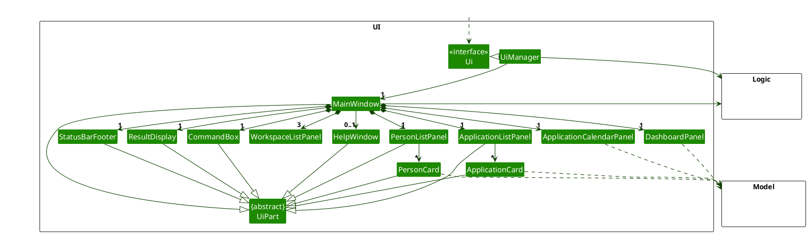

The UI consists of a `MainWindow` and its parts, such as `CommandBox`, `ResultDisplay`, `PersonListPanel`, `ApplicationListPanel`, `ApplicationCalendarPanel`, `DashboardPanel`, and `StatusBarFooter`. `MainWindow`, `CommandBox`, `ResultDisplay`, `StatusBarFooter`, `HelpWindow`, `PersonListPanel`, `ApplicationListPanel`, and the card classes inherit from the abstract `UiPart` class, which captures common behavior among classes that represent visible GUI parts. `ApplicationCalendarPanel`, `DashboardPanel`, and `WorkspaceListPanel` extend the JavaFX `VBox` directly instead. `WorkspaceListPanel`, which wraps the contacts, applications, and calendar views in a consistently styled page, is omitted from the diagram for clarity.

The `UI` component uses the JavaFX UI framework. The layouts of these UI parts are defined in matching `.fxml` files in `src/main/resources/view`. For example, [`MainWindow.fxml`](https://github.com/AY2627S1-CS2103T-T12-3/tp/blob/master/src/main/resources/view/MainWindow.fxml) specifies the layout of [`MainWindow`](https://github.com/AY2627S1-CS2103T-T12-3/tp/blob/master/src/main/java/seedu/address/ui/MainWindow.java).

The sequence diagram below shows how the Cmd+F (macOS) or Ctrl+F (Windows/Linux) shortcut prepares the command field for a contact search. If the field is empty or contains only whitespace, `find ` is inserted; otherwise, the current text is preserved. The command field receives focus and the caret moves to the end. The shortcut calls `focusForQuickSearch(false)` and does not execute the search. The sidebar find button calls `focusForQuickSearch(true)` and replaces any existing text with `find `.

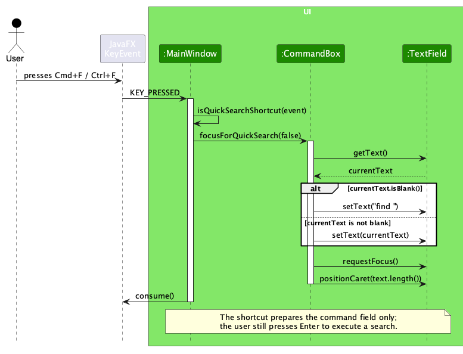

The `UI` component,

* executes user commands using the `Logic` component.
* listens for changes to `Model` data so that the UI can be updated with the modified data.
* keeps a reference to the `Logic` component, because the `UI` relies on the `Logic` to execute commands.
* depends on some classes in the `Model` component because it displays `Person` objects from the model.

The weekly application calendar is an `ApplicationCalendarPanel` that `MainWindow` displays when the user selects **Calendar** in the sidebar. The panel keeps the Monday that starts the selected week and redraws the header range and seven day columns whenever the user moves to the previous or next week. Each column lists the applications whose application date falls on that day, showing the role, company and status, or a placeholder if there are none. The range omits the year unless the week spans two years. The sequence diagram below shows this flow.

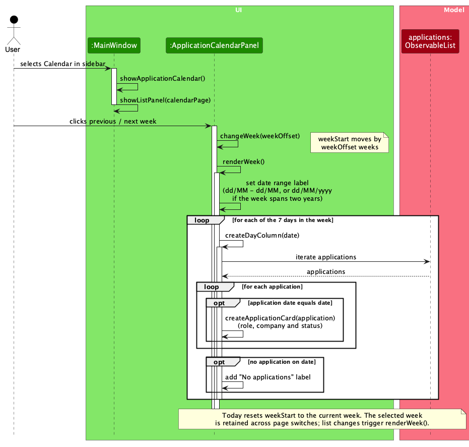

### Logic component

**API** : [`Logic.java`](https://github.com/AY2627S1-CS2103T-T12-3/tp/blob/master/src/main/java/seedu/address/logic/Logic.java)

Here's a (partial) class diagram of the `Logic` component:


The sequence diagram below illustrates the interactions within the `Logic` component, taking `execute("delete 1")` API call as an example.

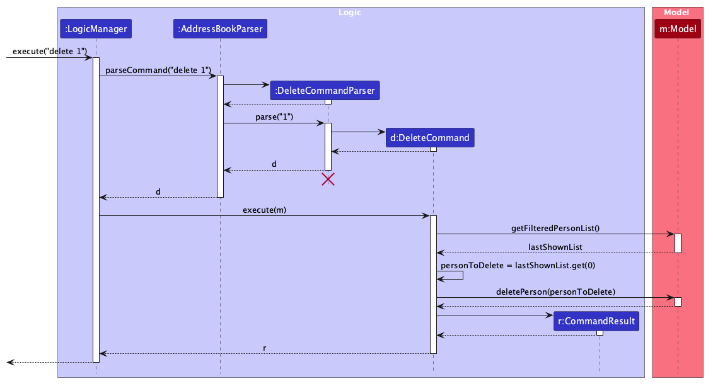

<div markdown="span" class="alert alert-info">:information_source: **Note:** The lifeline for `DeleteCommandParser` should end at the destroy marker (X), but due to a limitation of PlantUML, it continues to the end of the diagram.
</div>

How the `Logic` component works:

1. When `Logic` is called upon to execute a command, the command is passed to an `AddressBookParser` object, which in turn creates a parser that matches the command (e.g., `DeleteCommandParser`) and uses it to parse the command.
1. This results in a `Command` object (more precisely, an object of one of its subclasses e.g., `DeleteCommand`) which is executed by the `LogicManager`.
1. The command can communicate with the `Model` when it is executed (e.g. to delete a person).<br>
   For deletion, the command resolves the index against the filtered contact list before passing the selected person to the model.
1. The result of the command execution is encapsulated as a `CommandResult` object which is returned from `Logic`.

Here are the other classes in `Logic` (omitted from the class diagram above) that are used for parsing a user command:

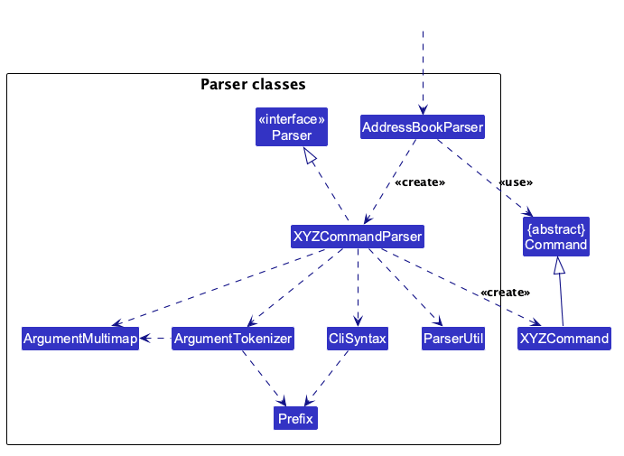

How the parsing works:
* When called upon to parse a user command, the `AddressBookParser` class creates an `XYZCommandParser` (`XYZ` is a placeholder for the specific command name, e.g., `AddCommandParser`). A command parser uses the relevant helper classes shown above to parse the user command and create an `XYZCommand` object (e.g., `AddCommand`). Different parsers use different helpers. The `AddressBookParser` returns that object as a `Command` object.
* All `XYZCommandParser` classes, such as `AddCommandParser` and `DeleteCommandParser`, implement the `Parser` interface so they can be treated similarly where appropriate, for example during testing.

### Model component
**API** : [`Model.java`](https://github.com/AY2627S1-CS2103T-T12-3/tp/blob/master/src/main/java/seedu/address/model/Model.java)

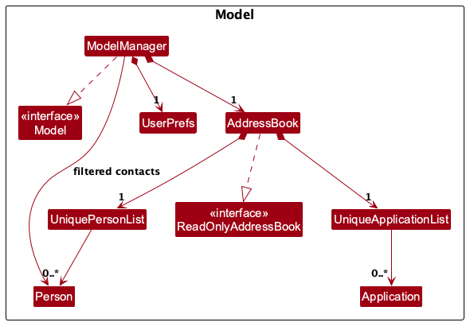

The following partial diagrams show the fields of contacts and applications.

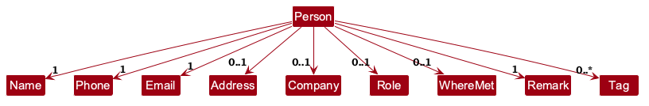

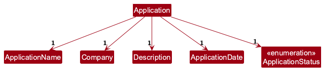


The `Model` component,

* stores the address book data i.e., all `Person` objects (which are contained in a `UniquePersonList` object) and all `Application` objects (which are contained in a `UniqueApplicationList` object).
* stores the `Person` objects selected by the current filter, such as search results, in a separate _filtered_ list. It exposes this list as an unmodifiable `ObservableList<Person>` that the UI can observe and bind to, so the UI updates when the list changes.
* stores a `UserPrefs` object that represents the user’s preferences (currently, just the GUI settings). This is exposed to the outside as a `ReadOnlyUserPrefs` object.
* does not depend on any of the other three components (as the `Model` represents data entities of the domain, they should make sense on their own without depending on other components)

`Person` stores its address as an `Optional<Address>`, giving the association a multiplicity of `0..1`.
`add` creates a contact without a supplied address; `getAddress()` returns the `Not provided` placeholder for display
when the optional is empty. `edit` can supply or replace a non-blank address, but cannot clear it with an empty `a/`.

Contact search updates the filtered list using `ContactContainsKeywordsPredicate`. It checks keywords against supplied contact fields until a case-insensitive, full-word match is found. Empty optional company, role, and where-met values and absent addresses are skipped. The `Person` model tracks whether an address is absent; older data without this flag treats the legacy `Not provided` value as absent. An explicitly supplied address with that value remains searchable. `FindCommand` includes its normalized search terms in `CommandResult`, and the contact panel keeps a `Filtered by` indicator visible while the predicate remains active and replaces its empty-list placeholder with a message suggesting `list`, so an empty search result is not mistaken for an empty contact list. `EditCommand` replaces the person without resetting the filtered list's predicate, so the filter is reapplied to the updated person and the indicator remains visible. After successful commands that reset the contact filter, the UI clears the indicator. The save-failure case is described in the implementation section. The activity diagram summarizes the matching logic.

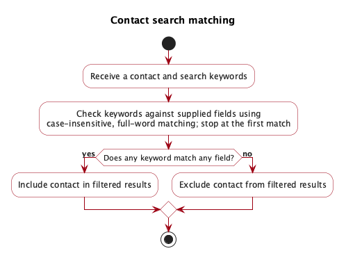

<div markdown="span" class="alert alert-info">:information_source: **Note:** The alternative, arguably more object-oriented, design below keeps a unique list of tags in `AddressBook`, and each `Person` references tags from that list. This lets `AddressBook` maintain one `Tag` object per unique tag instead of each `Person` holding its own `Tag` objects.<br>

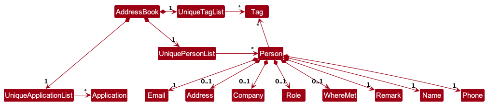

</div>


### Storage component

**API** : [`Storage.java`](https://github.com/AY2627S1-CS2103T-T12-3/tp/blob/master/src/main/java/seedu/address/storage/Storage.java)

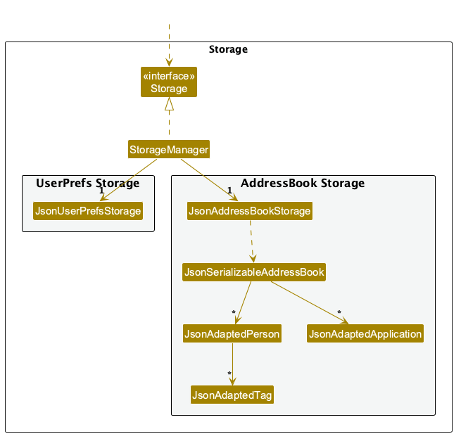

The `Storage` component,
* can save both address book data and user preference data in JSON format, and read them back into corresponding objects.
* is implemented by `StorageManager`, which delegates the actual JSON file access to `JsonAddressBookStorage` and `JsonUserPrefsStorage` (one class per data file).
* depends on some classes in the `Model` component (because the `Storage` component's job is to save/retrieve objects that belong to the `Model`)

### Common classes

Classes used by multiple components are in the `seedu.address.commons` package.

--------------------------------------------------------------------------------------------------------------------

## **Implementation**

This section describes some noteworthy details on how certain features are implemented.

### Saving changes safely

After a command successfully changes contacts or applications in memory, InternTrack attempts to save those records
before returning a successful result to the UI. After parsing a valid command and before executing it, `LogicManager`
copies the current `AddressBook` so that it can restore the contact and application records in memory if saving throws
an `IOException`.

The saving flow is as follows:

1. `LogicManager` parses the command, copies the current `AddressBook`, then executes the command.
1. If the command did not change contacts or applications, `LogicManager` returns its `CommandResult` without writing
   the data file. For example, `list` and `find` do not need write permission.
1. If the command changed the records, `LogicManager` asks `Storage` to save the updated `AddressBook`.
1. If saving succeeds, the command result is returned normally.
1. If saving throws an `AccessDeniedException` or another `IOException`, `LogicManager` restores the copied
   `AddressBook` through `Model#setAddressBook`, then throws a `CommandException` that the UI displays as an error.
   The command's record changes are therefore removed from memory.

This rollback restores contact and application records only; it does not restore the contact filter predicate or
other UI state. Storage writes directly to the JSON file, so this mechanism does not guarantee that the previous file
contents survive a failure partway through writing.

The following sequence shows the save and rollback paths for a valid command; parsing is shown at a high level.

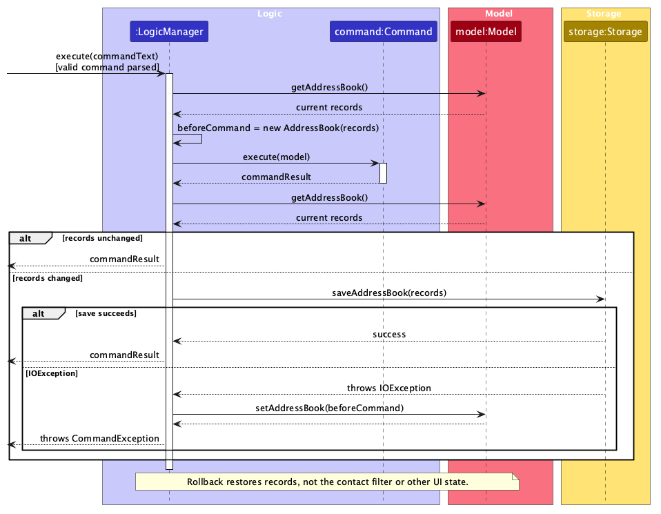

#### Design considerations

**Aspect: Restoring in-memory records when saving fails**

* **Alternative 1 (current choice):** Copy the complete `AddressBook` before executing a command and restore that
  copy if saving fails.
  * Pros: Command classes remain focused on their domain operation; record changes share the same handling of save
    errors; a failed save does not leave those changes in memory or return a successful command result to the UI.
  * Cons: Each command creates a copy of the records, which uses more memory as the data set grows.

* **Alternative 2:** Save a change before applying it to the `Model`.
  * Pros: Does not need to restore an in-memory copy after a failed save.
  * Cons: Commands would need a separate staged representation of every change, or would need to be replayed after
    saving. This duplicates command logic and makes validation and error handling harder to keep consistent.

### Multi-field contact search and active filters

The `find` command filters the existing contact list rather than building a separate search-result collection.
`edit`, `delete`, and `remark` resolve indexes against this filtered Contacts list, even when another page is open.
The numbers on Overview are not indexes into this list.

The search flow is as follows:

1. `FindCommandParser` rejects a blank query and splits a valid query into whitespace-separated keywords. If the
   complete query is a valid phone number, it also adds the normalized phone number to the search keywords so that a
   formatted query can match a stored phone number without separators.
1. `FindCommand` passes `ContactContainsKeywordsPredicate` to `Model#updateFilteredPersonList`.
1. The predicate checks keywords against the name, phone, email, company, role, where-met detail, supplied
   address, remark, and tags. A contact is retained when any keyword has a case-insensitive, full-word match in any
   of those fields. `StringUtil` ignores punctuation at the beginning or end of a word while matching.
1. `FindCommand` returns a `CommandResult` that requests the Contacts view and sets the active search term.
   `MainWindow` forwards that term to `PersonListPanel`, which displays the persistent `Filtered by:` indicator.

The following sequence illustrates a successful `find alex`; the matching activity diagram above focuses on the predicate.

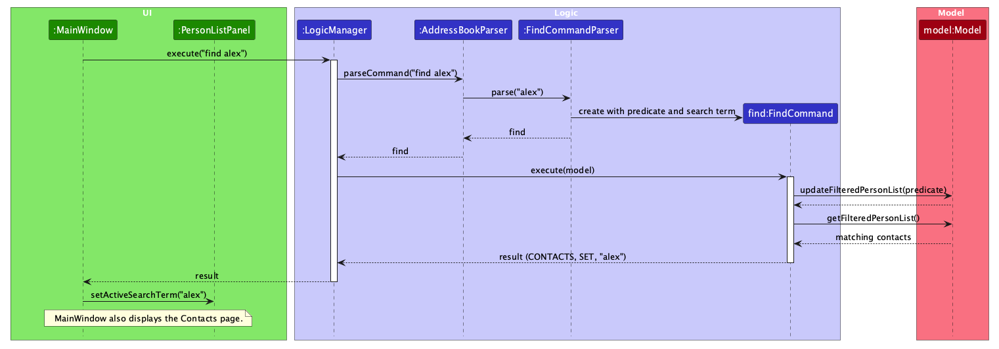

The `FilteredList<Person>` remains backed by the model's contact list. After successful `edit` and `delete` commands,
the active predicate remains in place and the search action leaves the indicator unchanged. The filtered list reflects
the updated records automatically. After `list`, `add`, or `remark` completes successfully, the show-all predicate is
active and the UI receives a clear search action, which removes the indicator.

The predicate is updated during command execution, but `MainWindow` updates the indicator only after `Logic` returns
a successful result. If saving an `add` or `remark` fails, the records are restored while the show-all predicate remains
active; the previous indicator is not cleared because the successful result is not returned. `list` can reset both to
the unfiltered state.

#### Design considerations

**Aspect: Search scope**

* **Alternative 1 (current choice):** Match any keyword against every contact field.
  * Pros: A user can locate a recruiter using whatever detail they remember, such as a company, tag, email, or
    where-met note. The same predicate also gives predictable OR behaviour for multiple keywords.
  * Cons: A broad keyword can return more contacts than a name-only search, and results are not ranked.

* **Alternative 2:** Search names only, or require every keyword to match.
  * Pros: Produces a narrower result list.
  * Cons: Does not support the product's goal of retrieving professional contacts from partial job-search context.

### Weekly application calendar

`ApplicationCalendarPanel` receives the live `ObservableList<Application>` from `Logic`. It stores the Monday of the
currently displayed week in `weekStart`; the previous and next controls move this date by one week, while **Today**
resets it to the Monday of the computer's current week.

`renderWeek` rebuilds the seven day columns for the selected Monday through Sunday range. For each day, it iterates
over the current application list, parses each recorded application date, and adds a card when the date matches that
day. A card displays the application's role, company, and status; a day with no matching applications receives a
`No applications` placeholder. The header omits years within a single year and shows both years for a week that spans
two years.

The panel registers a `ListChangeListener` on the application list. Any add, edit, or delete therefore re-renders the
currently selected week without maintaining a second, potentially stale date-grouped collection. When Calendar is
visible, `MainWindow` also keeps it visible after a successful `addapp`, `editapp`, or `deleteapp`, so the refreshed
week is shown immediately.

#### Design considerations

**Aspect: Updating the calendar after an application change**

* **Alternative 1 (current choice):** Rebuild the seven visible day columns from the live application list whenever
  that list changes.
  * Pros: Date edits, status edits, additions, and deletions use one update path; the displayed week cannot retain a
    stale card or cached date group.
  * Cons: Rendering iterates over the application list once per visible day.

* **Alternative 2:** Maintain a cached mapping from dates to application cards.
  * Pros: Could reduce repeated date comparisons for a large application list.
  * Cons: Every application mutation would have to update both the model and the cache correctly, including date
    changes and rollback after a failed save.

--------------------------------------------------------------------------------------------------------------------

## **Documentation, logging, testing, dev-ops**

* [Documentation guide](Documentation.md)
* [Testing guide](Testing.md)
* [Logging guide](Logging.md)
* [DevOps guide](DevOps.md)

--------------------------------------------------------------------------------------------------------------------

## **Appendix: Requirements**

### Product scope

**Target user profile**:

* is a university Computing student applying for multiple internships or graduate roles
* needs to keep application details and job-search contacts, such as recruiters, alumni, and referrers, together
* wants to find and update these records quickly while preparing applications and interviews
* prefers a desktop app and is comfortable using keyboard-driven CLI commands

**Value proposition**: InternTrack provides one keyboard-driven desktop workspace for recording internship and
graduate role applications alongside the professional contacts who can support a student's job search.


### User stories

Priorities: High (must have) - `* * *`, Medium (nice to have) - `* *`, Low (unlikely to have) - `*`

| Priority | As a …​  | I want to …​                                      | So that I can…​                                      |
| -------- | -------- | ------------------------------------------------- | ---------------------------------------------------- |
| `* * *`  | new user | see usage instructions                            | learn or recall how to use InternTrack               |
| `* * *`  | student  | add a professional contact                        | keep details of people relevant to my job search     |
| `* * *`  | student  | list my professional contacts                     | review my professional connections                   |
| `* * *`  | student  | search contacts by any field                      | retrieve relevant contact details quickly             |
| `* * *`  | student  | add an internship or graduate role application    | track each opportunity I apply for                    |
| `* * *`  | student  | list my internship and graduate role applications | review the opportunities I am pursuing               |
| `* *`    | student  | edit a professional contact                       | keep the contact's details accurate                   |
| `* *`    | student  | edit an application                               | keep its details current as my application progresses |
| `* *`    | student  | delete a professional contact or application      | remove a record that I no longer need                 |
| `* *`    | student  | record where I met a contact                       | remember how the contact is connected to my search   |

### Use cases

(For all use cases below, the **System** is `InternTrack` and the **Actor** is the `user`, unless specified otherwise)

**Use case: Add an internship or graduate role application**

**MSS**

1.  User enters the `addapp` command with the role, company, description, and application date.
2.  InternTrack checks that all required details are present and valid.
3.  InternTrack checks that an application with the same role and company does not already exist.
4.  InternTrack stores the application record.
5.  InternTrack confirms that the application was added.

    Use case ends.

**Extensions**

* 2a. A required application detail is missing or invalid.

    * 2a1. InternTrack shows an error message and does not save the application.

      Use case resumes at step 1.

* 3a. An application with the same role and company already exists.

    * 3a1. InternTrack informs the user that the application is a duplicate and does not save it.

      Use case ends.

**Use case: Edit a professional contact**

**MSS**

1.  User requests to list professional contacts.
2.  InternTrack shows the current list of professional contacts.
3.  User requests to edit a contact in the list, providing the details to update.
4.  InternTrack validates the updated contact details.
5.  InternTrack updates the professional contact.
6.  InternTrack confirms that the contact was updated.

    Use case ends.

**Extensions**

* 2a. The contact list is empty.

  Use case ends.

* 3a. The given contact index is invalid.

    * 3a1. InternTrack shows an error message.

      Use case resumes at step 2.

* 4a. An updated contact detail is invalid.

    * 4a1. InternTrack shows an error message.

      Use case resumes at step 3.

**Use case: Find a professional contact**

**MSS**

1.  User enters the `find` command with one or more keywords.
2.  InternTrack searches all contact fields using case-insensitive, full-word matching.
3.  InternTrack shows the contacts where any keyword matches any field.

    Use case ends.

**Extensions**

* 2a. No contact matches the supplied keywords.

    * 2a1. InternTrack shows that there are no matching contacts.

      Use case ends.

* 1a. The user does not supply any search keywords.

    * 1a1. InternTrack shows the command format.

      Use case ends.

### Non-Functional Requirements

1.  Should work on a _mainstream OS_ with Java `25` configured according to the course's Java setup requirements.
    macOS users must use the prescribed Azul JDK + JavaFX distribution.
2.  Should be able to hold up to 1000 professional contacts and application records without noticeable sluggishness
    during typical usage.
3.  A user with above average typing speed for regular English text should be able to add, edit, delete, and list
    records faster using commands than using the mouse.
4.  Contact and application records should remain available after the application is closed and reopened.
5.  The app should not require an internet connection for users to create, find, edit, or remove their local records.

### Glossary

* **Mainstream OS**: Windows, Linux, Unix, or macOS
* **Application record**: A record of an internship or graduate role application, including its role, company,
  description, and application date
* **Professional contact**: A person relevant to the user's internship or graduate-job search, such as a recruiter,
  interviewer, alumnus, or referrer
* **Application date**: The calendar date on which the user submitted an application, stored in `YYYY-MM-DD` format
* **Where met**: A short note describing how or where the user first met a professional contact
* **CLI**: Command Line Interface, a text-based interface through which users interact with InternTrack by typing
  commands

--------------------------------------------------------------------------------------------------------------------

## **Appendix: Instructions for Manual Testing**

This appendix provides a reproducible route through InternTrack's user-testable features, with representative valid
and invalid inputs. Run the sections in order unless a section states otherwise. Enter each command separately.
For command syntax and field constraints, refer to the [User Guide](UserGuide.md); explore additional variations
beyond the cases below.

### Test setup, launch and help

1. Follow [Quick start](UserGuide.md#quick-start) to configure the course-required JDK, including the prescribed
   Azul JDK + JavaFX distribution on macOS. Download `addressbook.jar` into a **new, empty, writable test folder**,
   separate from your real InternTrack data. In a terminal, change to this folder, run `java -version` to verify
   the active JDK, then launch with `java -jar "addressbook.jar"`
   (substitute the actual downloaded filename if it differs).<br>
   **Expected:** Overview opens with six sample contacts and no applications. `preferences.json` is created in
   the test folder. The app must not load records from your normal home folder.
2. Enter `help`, close the help window, then open it again using the top-right **Help** button and, separately,
   **F1**. Select **Copy URL** and paste into a browser.<br>
   **Expected:** Each method opens or focuses the help window. The copied URL points to the InternTrack User Guide;
   loading the website requires internet access. Close Help before continuing.
3. Enter `clear`, followed by `list` and `listapp`.<br>
   **Expected:** Both lists are empty, with messages suggesting `add` and `addapp` respectively. No confirmation
   prompt appears. **Use `clear` only in the disposable test folder.**

### Contacts: creation, fields and duplicate detection

1. Enter the following commands, one at a time:

   ```text
   add n/Ada Tester c/Example Labs r/Recruiter e/ada@example.com p/+65 9123-4567 w/Career Fair
   add n/Ben Tester c/Other Labs r/Engineer e/ben@example.com p/92345678
   list
   ```

   **Expected:** Contacts opens with two contacts: Ada at index `1` and Ben at index `2`. Ada's stored phone is
   `+6591234567` and where-met detail is `Career Fair`. Ben has no where-met detail. Both contacts start with
   address `Not provided`, no tags and no remark. The list message reports two contacts.
2. Enter `add n/ADA TESTER c/Third Labs r/Manager e/ADA@example.com p/93456789`.<br>
   **Expected:** A duplicate-contact error. There are still two contacts; Ada's existing details are unchanged.
3. Enter `add n/Missing Email c/Example Labs r/Recruiter p/94567890`.<br>
   **Expected:** A missing-required-field error. No contact is created. The failed input remains available to correct.

### Contacts: editing, tags, remarks and search

1. Enter `edit 1 c/Updated Labs r/Hiring Manager a/NUS Computing w/LinkedIn t/recruiter t/alumni`.<br>
   **Expected:** Ada's company, role, address and where-met detail are replaced, with tags `recruiter` and `alumni`.
   Name, email and phone are unchanged. The full Contacts list is shown.
2. Enter `edit 1 t/referrer`, then `edit 1 w/ t/`.<br>
   **Expected:** The first command replaces both old tags with `referrer`. The second removes the where-met detail
   and all tags. Neither command changes Ada's other fields.
3. Enter `edit 1 p/123`, then `edit 2 n/Ada Tester e/ada@example.com`.<br>
   **Expected:** The first command reports an invalid phone; the second reports a duplicate contact. Neither changes
   the saved contacts. `list` still shows Ada and Ben with their previous details.
4. Enter `find Ada`, then `remark 1 r/Met at university fair`.<br>
   **Expected:** Ada receives that remark, while her role remains `Hiring Manager`. The full Contacts list is restored
   and the search indicator disappears.
5. Enter `find Ada`, then `remark 1 r/first r/second`.<br>
   **Expected:** The repeated prefix is rejected; Ada's remark remains `Met at university fair`.
6. Enter `remark 1 r/`, then `find Ada`.<br>
   **Expected:** Ada's remark is removed and hidden on the card. The search returns Ada only, with
   `Filtered by: Ada` displayed above the results.
7. Select **Applications**, then **Contacts** in the sidebar.<br>
   **Expected:** The contact filter and indicator remain in effect. Switching pages does not clear them.
8. Enter `find UPDATED engineer`.<br>
   **Expected:** Both contacts appear: Ada matches her company and Ben matches his role. Matching is case-insensitive
   and uses OR across keywords and contact fields.
9. Enter `find Ad`, then `find nobodymatchesmanualtest`, then `list`.<br>
   **Expected:** Each search produces an empty list, because `Ad` is not the full word `Ada` and the other keyword
   matches no field. The empty list says that no contacts match the current search and suggests `list`, rather
   than suggesting `add`. `list` restores both contacts and removes the filter indicator.

### Applications: creation, fields, status and validation

1. Enter these commands separately:

   ```text
   addapp n/QA Intern c/Example Labs d/Applied online dt/2026-10-28
   addapp n/Graduate Engineer c/Other Labs d/Alumni referral dt/2026-10-29 s/interviewing
   listapp
   ```

   **Expected:** Applications shows two indexed cards. QA Intern is index `1`, with date `2026-10-28` and status
   Applied; Graduate Engineer is index `2`, with date `2026-10-29` and status Interviewing. Each card shows its name,
   company, description, date and status, with different status colours. The message reports two applications.
2. Enter `addapp n/qa intern c/EXAMPLE LABS d/Different description dt/2026-11-01`.<br>
   **Expected:** A duplicate-application error despite the different description and date. Two applications remain.
3. Enter `addapp n/Invalid Date c/Example Labs d/Date validation dt/2026-02-30`, then
   `editapp 1 s/PENDING`.<br>
   **Expected:** The invalid calendar date and unsupported status are rejected. No record is created or changed.
4. Enter `editapp 1 n/QA Engineer Intern c/Updated Labs d/Interview arranged dt/2026-10-30 s/OFFERED`.<br>
   **Expected:** All supplied fields change on the first card, which stays at index `1`. The second application
   remains unchanged. Its company is independent of any contact's company.
5. Enter `editapp 2 n/QA Engineer Intern c/Updated Labs`, then `editapp 1`.<br>
   **Expected:** The duplicate application edit and the edit with no fields are rejected; both cards retain their
   previous values.
6. Enter `list`, then `editapp 2 d/Prepare interview notes`.<br>
   **Expected:** The command edits Graduate Engineer, even though Contacts was open, and switches to Applications.
   Its other fields and both contacts remain unchanged.
7. Enter `addapp n/SWE Intern c/ACME (Singapore) d/Parentheses check dt/2026-11-04`, then
   `addapp n/SWE Intern c/ACME [Singapore] d/Brackets check dt/2026-11-04`.<br>
   **Expected:** The first application is added with the company `ACME (Singapore)`. The second is rejected because
   square brackets are not permitted in company names. Delete the SWE Intern application with `deleteapp` and its
   index so that two applications remain.

### Overview and sidebar quick commands

Prerequisite: The two contacts and two applications above remain in the test data; application statuses are Offered
and Interviewing.

1. Select **Overview**.<br>
   **Expected:** Active applications is `2` and Interviewing is `1`. The application table shows both applications.
   Contact cards appear in reverse Contacts order (Ben before Ada). Scroll as needed to inspect the content.
   Use Contacts list indexes, rather than Overview numbers, for contact commands.
2. Type `draft input` in the command box, then select the sidebar **addapp** quick command. Repeat with **add**.<br>
   **Expected:** Each button replaces the draft with its command word and a trailing space, focuses the box and
   positions the caret at the end. No record is added until a complete command is submitted. The current view stays open.
3. Empty the box and select the **find** quick command. Then replace its text with `list` and select **find** again.<br>
   **Expected:** Both actions replace the existing text with `find `. Both actions focus the command
   box without running a command. Clear the draft before continuing.

### Weekly application calendar

1. Select **Calendar**. Use the arrows to reach **26/10 – 01/11**, the week starting 26 October 2026.<br>
   **Expected:** All seven days, Monday through Sunday, remain visible. Graduate Engineer appears on Thursday
   29 October and QA Engineer Intern on Friday 30 October. Empty days show `No applications`. Cards show name,
   company and status; these dates represent application dates, not interview appointments.
2. Enter `editapp 1 dt/2026-10-31 s/REJECTED` while Calendar is open.<br>
   **Expected:** Calendar stays open on the same week. QA Engineer Intern moves from Friday to Saturday and shows
   REJECTED. Graduate Engineer is unchanged.
3. Enter `addapp n/Calendar Tester c/Calendar Labs d/Manual calendar check dt/2026-10-28 s/WITHDRAWN`.<br>
   **Expected:** Calendar stays open and adds Calendar Tester to Wednesday. This is application index `3` in the
   Applications list; calendar cards do not provide the indexes for application commands.
4. Enter `deleteapp 3` while Calendar is open.<br>
   **Expected:** The Wednesday card disappears without leaving the current week. The other two applications remain.
5. Navigate forward one week, then back; navigate to the week starting 28 December 2026; finally select **Today**.<br>
   **Expected:** The arrows change the displayed week. The first week without test applications has no application
   cards. The year-crossing range shows `28/12/2026 – 03/01/2027`. Today returns to the computer's current week and
   highlights today's column; test applications appear only if their dates fall within that week.
6. Select **Overview**.<br>
   **Expected:** Active applications is now `1` and Interviewing is `1`: Rejected is excluded from the active count.
   The Withdrawn application was deleted. Use the sidebar to return to either list.

### Keyboard search and command history

1. Clear the command box. Press **Cmd+F** on macOS or **Ctrl+F** on Windows/Linux, type `Ada` after the prepared
   `find ` and press Enter.<br>
   **Expected:** The shortcut focuses the box and inserts `find `; submitting the command opens Contacts with only Ada.
2. Type `list` without submitting and press the same shortcut.<br>
   **Expected:** The existing text is preserved and the caret moves to its end. Press Enter to restore both contacts.
3. Enter `listapp`, then `notacommand`. Replace the rejected input with `unfinished draft` without submitting it.
   Press Up twice, then Down twice.<br>
   **Expected:** Up recalls `notacommand`, then `listapp`; Down returns to `notacommand`, then restores
   `unfinished draft`. Invalid commands are included in history. Clear the draft before continuing.

### Saving, shutdown, backup and recovery

Prerequisite: Two contacts and two applications remain. Ada has no where-met detail, tags or remark. QA Engineer
Intern has date `2026-10-31` and status Rejected; Graduate Engineer is Interviewing.

1. Resize and reposition the main window, enter `exit`, then relaunch the same JAR from the same test folder.<br>
   **Expected:** The app closes and reopens; window size and position are retained. `list` and `listapp` show the
   same records and edited values. A new app session does not retain the previous command history.
2. Close the app using the window's close button. Copy `data/addressbook.json` to a backup outside the test
   folder, then relaunch and enter `clear`.<br>
   **Expected:** Window-close shutdown works; `clear` empties both lists immediately. Exit again, replace
   `data/addressbook.json` with the backup and relaunch.<br>
   **Expected after restore:** Both contacts and both applications return with their saved values. Follow the
   [UG backup instructions](UserGuide.md#backing-up-and-restoring-data) when transferring the file to another computer.
3. Optional save-failure test: with the app closed and a backup preserved, make the test data file or folder
   non-writable using your OS's file permissions. Relaunch and run
   `addapp n/Permission Test c/Test Labs d/Should not save dt/2026-10-29`.<br>
   **Expected, if the OS denies the write:** A save-permission error is shown and the new application is rolled back;
   `listapp` still contains only the previous two records. Restore write permissions before continuing. This test
   is not meaningful if your OS account can override the permissions.
4. Optional invalid-file recovery test: close the app, preserve the valid backup and replace the contents of the
   test `data/addressbook.json` with `not valid JSON`. Relaunch.<br>
   **Expected:** Both lists start empty; the invalid file is not immediately replaced by a read-only `list` or
   `listapp`. Close the app and restore the valid backup before continuing. Do not run a record-changing command
   until you have preserved any data you need.

### Deletion, invalid indexes and final cleanup

Prerequisite: Restore the valid backup from the preceding section, if needed, so there are two contacts and two
applications. The following commands intentionally remove test records.

1. Enter `list`, then `delete 0`; enter `listapp`, then `deleteapp 99` and `deleteapp 1 2`.<br>
   **Expected:** Each invalid command reports an error without deleting any record. The last command rejects
   multiple indexes rather than deleting either application.
2. Enter `find Ben`, then `delete 1`.<br>
   **Expected:** Only Ben is deleted. Contacts opens with no matching results and the Ben filter remains active.
   Enter `list`: Ada is now index `1`. Both applications remain.
3. Enter `listapp`, then `deleteapp 2`, then `deleteapp 1`, then `listapp`.<br>
   **Expected:** Graduate Engineer is removed first and QA Engineer Intern remains at index `1`; after deleting it,
   the list is empty and suggests `addapp`. Ada remains in Contacts.
4. Enter `clear`, then `list` and `listapp`, then `exit`.<br>
   **Expected:** All remaining test records are removed, both lists are empty and the app exits. Relaunching from
   this test folder keeps the saved empty lists rather than recreating the sample contacts.
