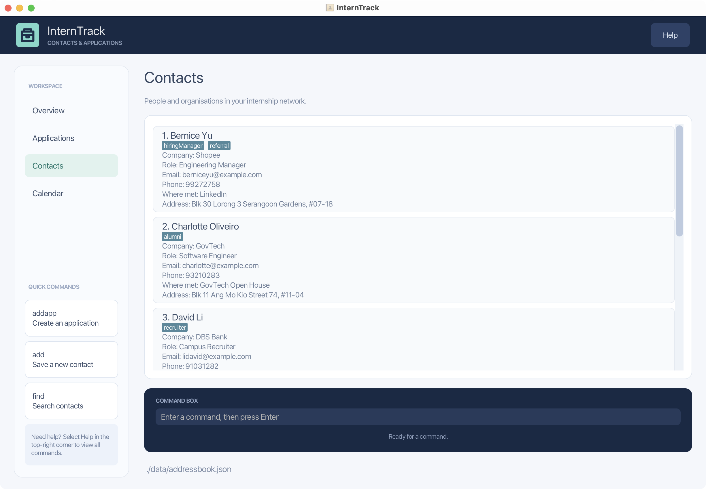

InternTrack is a **desktop application for tracking internship and graduate-role applications alongside professional contacts**. It combines a graphical user interface (GUI) with a command line interface (CLI) for users who prefer entering and finding records by typing commands.

* Table of Contents
{:toc}

--------------------------------------------------------------------------------------------------------------------

## Quick start

1. Ensure that Java `25` is installed on your computer. Run `java -version` in a terminal to check. 
   **Mac users:** Ensure you have the precise JDK version prescribed [here](https://se-education.org/guides/tutorials/javaInstallationMac.html).

1. Download the latest InternTrack JAR from the [GitHub releases page](https://github.com/AY2627S1-CS2103T-T12-3/tp/releases). On an Apple Silicon Mac using an arm64 Java installation, choose `addressbook-mac-arm64.jar`. On an Intel Mac, Windows, or Linux, choose `addressbook.jar`.

1. Copy the JAR file to the folder you want to use as InternTrack's _home folder_.

1. Open a terminal, `cd` to the folder containing the JAR file, and run `java -jar addressbook.jar` (or `java -jar addressbook-mac-arm64.jar` if you downloaded the Apple Silicon version). 
   A GUI similar to the one below should appear in a few seconds. Note how the app contains some sample data. 
   

1. Type a command in the command box and press Enter to execute it. For example, type **`help`** and press Enter to open the help window. 
   Some example commands you can try:

   * `list` : Lists all contacts.

   * `add n/John Doe c/Google r/SWE Recruiter e/johnd@example.com p/98765432 w/Career fair` : Adds a contact named `John Doe`.

   * `delete 3` : Deletes the 3rd contact shown in the current list.

   * `clear` : Deletes all contacts and applications.

   * `exit` : Exits the app.

1. Refer to the [Features](#features) section below for details of each command.

--------------------------------------------------------------------------------------------------------------------

## Keyboard shortcuts

Press `Cmd+F` on macOS or `Ctrl+F` on Windows/Linux to focus the command box. If it is empty, InternTrack prepares `find ` for you; existing text is preserved and the caret moves to the end. Press Enter after entering the search keywords to run the command.

In the command box, press **Up** to recall earlier commands and **Down** to move toward newer ones. Moving past the newest command restores the text you were typing. History lasts for the current app session and includes commands that returned an error, so you can edit and retry them.

--------------------------------------------------------------------------------------------------------------------

## Features

**:information_source: Notes about the command format:** 

* Words in `UPPER_CASE` are the parameters to be supplied by the user. 
  For example, in `add n/NAME`, replace `NAME` with a value such as `John Doe`.

* Items in square brackets are optional. 
  For example, `n/NAME [t/TAG]` can be used as `n/John Doe t/friend` or as `n/John Doe`.

* Items followed by `…`​ can appear zero or more times. 
  For example, `[t/TAG]…​` may be omitted, or written as `t/friend` or `t/friend t/family`.

* Parameters can be in any order. 
  For example, if the command specifies `n/NAME p/PHONE_NUMBER`, `p/PHONE_NUMBER n/NAME` is also acceptable.

* Extraneous parameters for commands that take no parameters, such as `help`, `list`, `listapp`, `exit`, and `clear`, are ignored. 
  For example, `help 123` is interpreted as `help`.

* If you are using a PDF version of this document, be careful when copying and pasting commands that span multiple lines as space characters surrounding line-breaks may be omitted when copied over to the application.

### Viewing help: `help`

Shows a message explaining how to access the help page.

Format: `help`

### Adding a contact: `add`

Adds a professional contact to InternTrack.

Format: `add n/NAME c/COMPANY r/ROLE e/EMAIL p/PHONE_NUMBER [w/WHERE_MET]`

* All fields except `WHERE_MET` are required.
* `COMPANY` is the company the person works at. It may only contain letters, digits, spaces and `& . , ' -`, and must not exceed 100 characters.
* `ROLE` is the role the person holds, such as `SWE Recruiter`. It may only contain letters, digits, spaces and `& . , ' -`, and must not exceed 100 characters.
* `WHERE_MET` is optional and describes how or where you met the person. It may only contain letters, digits, spaces and `& . , ' -`, and must not exceed 200 characters.
* `NAME` may contain Unicode letters, digits, spaces, hyphens, and apostrophes. It must contain at least one letter or digit and be no longer than 100 characters. Leading and trailing whitespace is removed, and internal whitespace is reduced to one space.
* `PHONE_NUMBER` must contain 7 to 15 digits, with an optional leading `+`. Spaces and hyphens can separate digits; they are removed when the phone number is stored.
* Two contacts with the same name and email address are considered duplicates, ignoring letter case.
* After a contact is added, InternTrack shows the contact list so the new record is visible.

Examples:
* `add n/John Doe c/Google r/SWE Recruiter e/john@example.com p/98765432 w/Career fair 2026`
* `add c/Meta r/Software Engineer e/jane@meta.com n/Jane Lim w/LinkedIn p/91234567`
* `add n/Sam Tan c/Grab r/HR e/sam@grab.com p/91112222` adds a contact without a where-met detail

### Adding an application: `addapp`

Adds an internship or graduate-role application to InternTrack.

Format: `addapp n/NAME c/COMPANY d/DESCRIPTION dt/YYYY-MM-DD [s/STATUS]`

* All four fields are required.
* `NAME` is the role or position title. It must not be blank, contain control characters, or exceed 100 characters.
* `COMPANY` is standalone text; it is not linked to an existing contact. It may only contain letters, digits, spaces and `& . , ' -`, and must not exceed 100 characters.
* `DESCRIPTION` records relevant application details. It must not be blank or exceed 500 characters.
* `DESCRIPTION` can contain short text that looks like a field, such as `n/a`, `s/o` or `c/o`. A prefix followed by a single letter is kept as part of the description, so to set a one-letter field, place it before `d/`.
* `DATE` must be a valid calendar date in the **`YYYY-MM-DD`** format, from `2000-01-01` to `2099-12-31`. For example, use `2026-10-07`, not `07-10-2026` or `2026-02-30`.
* `STATUS` is optional. If omitted, the application is created with the `APPLIED` status.
* The accepted status values are `APPLIED`, `INTERVIEWING`, `OFFERED`, `REJECTED`, and `WITHDRAWN`. Status values are case-insensitive.
* Two applications with the same `NAME` and `COMPANY` are considered duplicates, ignoring letter case and repeated spaces. Their descriptions and dates do not affect duplicate detection.

Examples:
* `addapp n/Software Engineer Intern c/Tech Corp d/Applied through the company careers page. dt/2026-10-07`
* `addapp c/Example Pte Ltd d/Referred by a university alumnus. dt/2026-11-15 s/INTERVIEWING n/Product Manager Intern`

After an application is added, InternTrack switches to the application list so that the new record is visible.

### Editing an application: `editapp`

Edits an existing internship or graduate-role application.

Format: `editapp INDEX [n/NAME] [c/COMPANY] [d/DESCRIPTION] [dt/YYYY-MM-DD] [s/STATUS]`

* Run `listapp` to see the application indexes. `INDEX` must be a positive integer referring to an existing application.
* At least one field must be provided. Fields may appear in any order, but each prefix may appear only once.
* Supplied fields replace the existing values; omitted fields remain unchanged. Supplying the same value is allowed.
* All values follow the constraints described under `addapp`. Fields cannot be cleared with an empty value.
* Use `s/STATUS` to update only the application's status. The accepted values are `APPLIED`, `INTERVIEWING`, `OFFERED`, `REJECTED`, and `WITHDRAWN`.
* An edit cannot give an application the same name and company as another application, ignoring letter case and repeated spaces.
* On success, the application list is shown and the edited card stays at the same position.
* The index always refers to the application list, even when you are viewing contacts. Contacts are unaffected.
* Changes are saved automatically. Invalid commands leave the saved applications unchanged.

Examples:
* `listapp` followed by `editapp 1 d/Interview scheduled.` updates only the first application's description.
* `editapp 2 n/Graduate Software Engineer c/Example Pte Ltd dt/2026-10-15` updates the second application's name,
  company and date, keeping its description.
* `editapp 1 s/OFFERED` updates only the first application's status.

### Deleting an application: `deleteapp`

Deletes an existing application immediately.

Format: `deleteapp INDEX`

* Run `listapp` to see the application indexes. `INDEX` must be a positive integer referring to an existing application.
* Only one index is accepted. Additional indexes or parameters are invalid.
* The index always refers to the application list, even when you are viewing contacts. Contacts are unaffected.
* On success, the application list is shown and the remaining cards are renumbered. Deleting the final application
  leaves an empty application list.
* The deletion is saved automatically. An invalid index leaves the saved applications unchanged.

Example:
* `listapp` followed by `deleteapp 2` deletes the second application.

### Listing all applications: `listapp`

Shows all internship and graduate-role applications in InternTrack, separately from contacts.

Format: `listapp`

* Each application card shows its Name, Company, Description, Date, and Status. Status text uses a different colour for each status.
* The result box shows how many applications are listed.
* If you have no applications, InternTrack tells you so and suggests using `addapp` to add one.

Examples:
* `listapp` shows all saved applications.
* Run `list` to return to the contact list.

### Viewing application dates in the weekly calendar

Choose **Calendar** in the sidebar to see applications arranged by their recorded application date for the current week. All seven days are visible. The date range appears at the top in `dd/mm – dd/mm` format. Use the left and right arrow buttons to move between weeks, or **Today** to return to the current week. Today's column is highlighted. Each application card shows its name, company, and status. Each day remains visible when it has no applications. Weeks that cross into a new year show the year on both dates.

Choose **Contacts** or **Applications** in the sidebar to return to either list.

### Listing all contacts: `list`

Shows all contacts in InternTrack, clearing any filter applied by a previous `find`.

Format: `list`

* Each contact card shows the contact's name, company, role, email, phone number and where you met them, followed by their address, remark and tags.
* Optional fields that have not been filled in, such as company, role or where met, are hidden from the card.
* The result box shows how many contacts are listed.
* If you have no contacts, InternTrack tells you so and suggests using `add` to add one.

Examples:
* `list` shows all 6 sample contacts when you first launch InternTrack.

### Editing a person: `edit`

Edits an existing person in the address book.

Format: `edit INDEX [n/NAME] [p/PHONE] [e/EMAIL] [c/COMPANY] [r/ROLE] [a/ADDRESS] [w/WHERE_MET] [t/TAG]…​`

* Edits the person at the specified `INDEX`. The index refers to the index number shown in the displayed person list. The index **must be a positive integer** 1, 2, 3, …​
* At least one of the optional fields must be provided.
* Existing values will be updated to the input values.
* When editing tags, all of the person's existing tags are removed; adding tags is not cumulative.
* To remove all of a person's tags, enter `t/` without a tag after it.
* To remove a person's where-met detail, enter `w/` without a value after it.

Examples:
*  `edit 1 p/91234567 e/johndoe@example.com` Edits the phone number and email address of the 1st person to be `91234567` and `johndoe@example.com` respectively.
*  `edit 2 n/Betsy Crower t/` Edits the name of the 2nd person to be `Betsy Crower` and clears all existing tags.
*  `edit 3 c/Meta, Inc.` Edits the company of the 3rd person to be `Meta, Inc.`.
*  `edit 1 r/Software Engineer` Edits the role of the 1st person to be `Software Engineer`.
*  `edit 3 w/LinkedIn` Edits where the 3rd person was met to be `LinkedIn`.

### Adding or removing a remark: `remark`

Adds, replaces, or removes the remark of a contact.

Format: `remark INDEX r/[REMARK]`

* `INDEX` must be a positive integer referring to a contact in the displayed list.
* The supplied remark replaces any existing remark for that contact.
* To remove a remark, enter `r/` without any text after it.

Examples:
* `remark 1 r/Met at NUS Career Fair` adds or replaces the remark of the 1st contact.
* `remark 1 r/` removes the remark of the 1st contact.

### Locating contacts by keyword: `find`

Finds contacts whose fields contain any of the given keywords.

Format: `find KEYWORD [MORE_KEYWORDS]`

* The search is case-insensitive; for example, `hans` matches `Hans`.
* Keyword order does not matter; for example, `Hans Bo` matches `Bo Hans`.
* The search considers names, phone numbers, email addresses, companies, roles, where-met details, addresses, remarks, and tags.
* Only full words match; for example, `Han` does not match `Hans`.
* Punctuation at the start or end of a word is ignored; for example, `Google` matches the company `Google, Inc.`.
* Contacts matching at least one keyword are returned (an `OR` search); for example, `Google Recruiter` returns contacts whose company contains `Google` or whose role contains `Recruiter`.
* Contacts without optional company, role, or where-met details can still be found using their other fields.
* The contact list shows `Filtered by: KEYWORDS` above the results. This indicator stays visible when you navigate away from Contacts and return. It clears when `list`, `add`, `edit`, or `remark` resets the contact filter.

Examples:
* `find John` returns `john` and `John Doe`
* `find Google` returns contacts whose company contains `Google`
* `find Recruiter` returns contacts whose role contains `Recruiter`
* `find 85355255` returns contacts whose phone number is `85355255`
* `find +65 9123-4567` returns contacts whose phone number is `+6591234567`
* `find LinkedIn` returns contacts whose where-met details contain `LinkedIn`
* `find alex david` returns matching contacts such as `Alex Yeoh` and `David Li`.

### Deleting a person: `delete`

Deletes the specified person from the address book.

Format: `delete INDEX`

* Deletes the person at the specified `INDEX`.
* The index refers to the index number shown in the displayed person list.
* The index **must be a positive integer** 1, 2, 3, …​

Examples:
* `list` followed by `delete 2` deletes the 2nd person in the address book.
* `find Betsy` followed by `delete 1` deletes the 1st person in the results of the `find` command.

### Clearing all entries: `clear`

Deletes all contacts and applications from InternTrack. This cannot be undone.

Format: `clear`

### Exiting the program: `exit`

Exits the program.

Format: `exit`

### Saving the data

InternTrack automatically saves data after every successful command. You do not need to save manually.

### Editing the data file

InternTrack stores contacts and applications in the JSON file `[JAR file location]/data/addressbook.json`. Advanced users are welcome to update that data file directly.

:exclamation: **Caution:**
If your changes make the data file invalid, InternTrack starts with an empty contact and application list at the next run. The invalid file remains on disk until a successful command saves valid data. We recommend backing up the file before editing it. 
Certain edits can also cause InternTrack to behave in unexpected ways (e.g., if a value entered is outside of the acceptable range). Edit the data file only if you are confident that you can update it correctly.

### Archiving data files `[coming in v2.0]`

_Details coming soon ..._

--------------------------------------------------------------------------------------------------------------------

## FAQ

**Q**: How do I transfer my data to another computer? 
**A**: Install InternTrack on the other computer and copy the data file from your previous home folder into its `data` folder.

--------------------------------------------------------------------------------------------------------------------

## Known issues

1. **When using multiple screens**, if you move the application to a secondary screen, and later switch to using only the primary screen, the GUI will open off-screen. The remedy is to delete the `preferences.json` file created by the application before running the application again.
2. **If you minimize the Help Window** and then run the `help` command (or use the `Help` menu, or the keyboard shortcut `F1`) again, the original Help Window will remain minimized, and no new Help Window will appear. The remedy is to manually restore the minimized Help Window.

--------------------------------------------------------------------------------------------------------------------

## Command summary

Action | Format, Examples
--------|------------------
**Add contact** | `add n/NAME c/COMPANY r/ROLE e/EMAIL p/PHONE_NUMBER [w/WHERE_MET]`   e.g., `add n/James Ho c/Google r/SWE Recruiter e/jamesho@example.com p/22224444 w/Career fair`
**Add application** | `addapp n/NAME c/COMPANY d/DESCRIPTION dt/YYYY-MM-DD [s/STATUS]`  e.g., `addapp n/Software Engineer Intern c/Tech Corp d/Applied through the company careers page. dt/2026-10-07 s/APPLIED`
**Edit application** | `editapp INDEX [n/NAME] [c/COMPANY] [d/DESCRIPTION] [dt/YYYY-MM-DD] [s/STATUS]`  e.g., `editapp 1 s/INTERVIEWING`
**Delete application** | `deleteapp INDEX`  e.g., `deleteapp 2`
**Clear** | `clear`
**Delete** | `delete INDEX`  e.g., `delete 3`
**Edit** | `edit INDEX [n/NAME] [p/PHONE_NUMBER] [e/EMAIL] [c/COMPANY] [r/ROLE] [a/ADDRESS] [w/WHERE_MET] [t/TAG]…​`  e.g., `edit 2 n/James Lee e/jameslee@example.com r/Software Engineer w/LinkedIn`
**Exit** | `exit`
**Remark** | `remark INDEX r/[REMARK]`  e.g., `remark 1 r/Met at NUS Career Fair`
**Find** | `find KEYWORD [MORE_KEYWORDS]`  e.g., `find Google Recruiter`
**List** | `list`
**List applications** | `listapp`
**Help** | `help`
