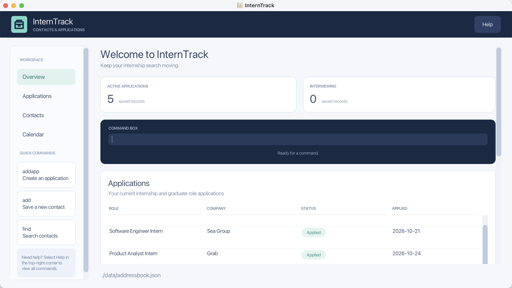
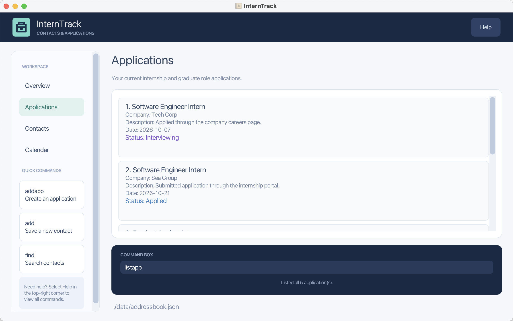
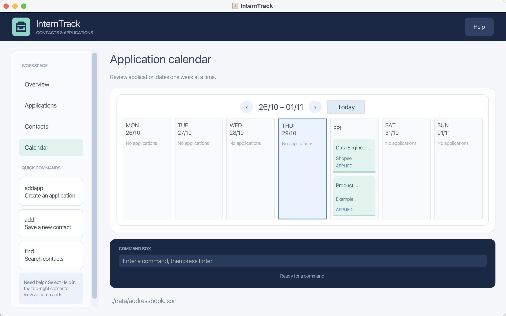
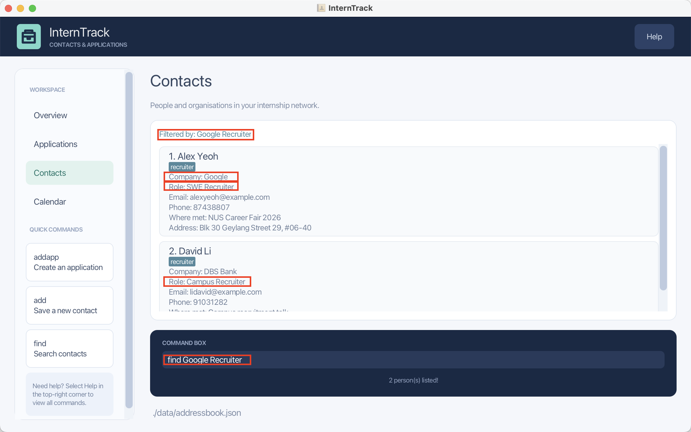

InternTrack helps **university Computing students track internship and graduate-role applications alongside their professional contacts on one computer**. Keep application progress, recruiters, alumni and referrers together without switching between separate lists. It combines a graphical user interface (GUI) with a command line interface (CLI) for users who prefer entering and finding records by typing commands. InternTrack stores your records locally; you remain responsible for submitting applications and contacting employers.

- Table of Contents
  {:toc}

---

## Quick start

1. Ensure that Java `25` is installed on your computer. Run `java -version` in a terminal to check. 
   **Mac users:** Ensure you have the precise JDK version prescribed [here](https://se-education.org/guides/tutorials/javaInstallationMac.html).

1. Download the latest InternTrack JAR from the [GitHub releases page](https://github.com/AY2627S1-CS2103T-T12-3/tp/releases). On an Apple Silicon Mac using an arm64 Java installation, choose `addressbook-mac-arm64.jar`. On an Intel Mac, Windows, or Linux, choose `addressbook.jar`.

1. Create an empty folder that you can write to and copy the JAR into it. This will be your InternTrack _home folder_. The app needs permission to create its data and settings files there; avoid read-only folders.

1. Open a terminal, `cd` to the folder containing the JAR file, and run `java -jar "addressbook.jar"` (or `java -jar "addressbook-mac-arm64.jar"` for the Apple Silicon version). If your downloaded file has a different name, use that exact name inside the quotes. Launch from the terminal: double-clicking may not work on some systems or may use a different Java version. 
   The app opens on **Overview**. A new home folder starts with six sample contacts and no applications. On subsequent launches, the app loads the records saved in that home folder.

1. Type a command in the command box and press Enter to execute it. For example, type **`help`** and press Enter to open the help window. 
   Some example commands you can try:
    - `list` : Lists all contacts.

    - `add n/John Doe c/Google r/SWE Recruiter e/johnd@example.com p/98765432 w/Career fair` : Adds a contact named `John Doe`.

1. Run `list` to open Contacts. The screenshot below illustrates this view; its records may differ from yours.

    

1. Refer to [Getting around](#getting-around) for the workspace and [Features](#features) for command details. The [Command summary](#command-summary) is a quick reference.

**Linux:** If launch fails with a `Gdk-CRITICAL` error on Wayland, try `GDK_BACKEND=x11 java -jar "addressbook.jar"` from the same folder.

---

## Getting around

Use the left sidebar to switch between these views:

| View             | What it shows                                                                                                                                                                               |
| ---------------- | ------------------------------------------------------------------------------------------------------------------------------------------------------------------------------------------- |
| **Overview**     | A summary of applications and contacts, with the counts explained below. Below are an application table and contact cards, with contacts in reverse list order. Scroll to see more content. |
| **Applications** | Indexed application cards. Run `listapp` before choosing an index for `editapp` or `deleteapp`.                                                                                             |
| **Contacts**     | Indexed contact cards, including any active `find` filter. Run `list` to remove the filter.                                                                                                 |
| **Calendar**     | Applications grouped by their application dates in a Monday-to-Sunday weekly calendar. See [Viewing application dates](#viewing-application-dates-in-the-weekly-calendar).                  |

**Overview application counts:**

 <em>Overview summarises active applications, interviewing applications and professional contacts.</em>

- **Active applications** includes applications with status `APPLIED`, `INTERVIEWING` or `OFFERED`. Applications with status `REJECTED` or `WITHDRAWN` are excluded. An `OFFERED` application still counts as active.
- **Interviewing** includes only applications with status `INTERVIEWING`. These applications also count towards **Active applications**.

The **COMMAND BOX** accepts one command at a time. Press **Enter** to run it; the message below reports success or explains what needs correcting. A failed command stays in the box so you can edit and retry it.

Under **QUICK COMMANDS**, selecting **addapp** or **add** replaces the command-box text with `addapp ` or `add `. Complete the fields and press Enter; selecting the button alone does not create a record. **find** focuses the box and inserts `find ` only if it is blank; existing text is preserved. These buttons prepare commands without changing the current view.

**Choose indexes from the correct list.** Contact commands (`edit`, `remark`, `delete`) use the current Contacts list, including its search filter, even while you are viewing another page. Application commands (`editapp`, `deleteapp`) use the Applications list. Overview numbers are not contact-command indexes, because Overview displays contacts in a different order. Open the appropriate list and check the record before changing or deleting it.

## Keyboard shortcuts

Press `Cmd+F` on macOS or `Ctrl+F` on Windows/Linux to focus the command box. If it is empty, InternTrack prepares `find ` for you; existing text is preserved and the caret moves to the end. Press Enter after entering the search keywords to run the command.

Press **F1**, select **Help** at the top right, or enter `help` to open the help window.

In the command box, press **Up** to recall earlier commands and **Down** to move toward newer ones. Moving past the newest command restores the text you were typing. History lasts for the current app session and includes commands that returned an error, so you can edit and retry them.

---

## Features

**:information_source: Notes about the command format:** 

- Words in `UPPER_CASE` are the parameters to be supplied by the user. 
  For example, in `add n/NAME`, replace `NAME` with a value such as `John Doe`.

- Items in square brackets are optional. 
  For example, `add n/NAME c/COMPANY r/ROLE e/EMAIL p/PHONE_NUMBER [w/WHERE_MET]` allows you to omit `w/WHERE_MET`.

- Items followed by `…` can appear zero or more times. 
  For example, in `edit`, `[t/TAG]…` may be omitted, or written as `t/friend` or `t/friend t/family`.

- Command words and prefixes are case-sensitive: use `addapp`, not `ADDAPP`, and `n/`, not `N/`. Status values are case-insensitive.

- Separate each field prefix from the preceding text with a normal space. Do not type the square brackets shown in formats. Values containing spaces do not need quotation marks; for example, use `n/John Doe`.

- Each field prefix may appear only once, except `t/` in `edit`, which can be repeated for multiple tags. A recognised prefix preceded by a space normally starts a new field rather than remaining part of the previous value; see the description-text exception under [Adding an application](#adding-an-application-addapp).

- Prefixed fields can be in any order. For commands that use `INDEX`, keep the index immediately after the command word and before the fields. 
  For example, if the command specifies `n/NAME p/PHONE_NUMBER`, `p/PHONE_NUMBER n/NAME` is also acceptable.

- Extraneous parameters for commands that take no parameters, such as `help`, `list`, `listapp`, `exit`, and `clear`, are ignored. 
  For example, `help 123` is interpreted as `help`.

- If you are using a PDF version of this document, be careful when copying and pasting commands that span multiple lines as space characters surrounding line-breaks may be omitted when copied over to the application.
    

### Viewing help: `help`

Opens a window containing the User Guide web address. Select **Copy URL** and paste it into your browser to read the guide. An internet connection is needed to load the online guide; your local records can be managed offline.

Format: `help`

### Adding a contact: `add`

Adds a professional contact to InternTrack.

Format: `add n/NAME c/COMPANY r/ROLE e/EMAIL p/PHONE_NUMBER [w/WHERE_MET]`

- All fields except `WHERE_MET` are required.
- `COMPANY` is the company the person works at. It may only contain letters, digits, spaces and `& . , ' -`, and must not exceed 100 characters.
- `ROLE` is the role the person holds, such as `SWE Recruiter`. It may only contain letters, digits, spaces and `& . , ' -`, and must not exceed 100 characters.
- `WHERE_MET` is optional and describes how or where you met the person. It may only contain letters, digits, spaces and `& . , ' -`, and must not exceed 200 characters.
- `NAME` may contain Unicode letters, digits, spaces, hyphens, and apostrophes. It must contain at least one letter or digit and be no longer than 100 characters. Leading and trailing whitespace is removed, and internal whitespace is reduced to one space.
- `EMAIL` must have the form `local-part@domain`, such as `john@example.com`. The local part accepts ASCII letters, digits and `+ _ . -`, with letters or digits at both ends and no consecutive special characters. Domain labels use ASCII letters and digits, separated by single hyphens if needed; labels are separated by dots and the final label has at least two characters. Invalid input produces a detailed error message.
- `PHONE_NUMBER` must contain 7 to 15 digits, with an optional leading `+`. Spaces and hyphens can separate digits; they are removed when the phone number is stored.
- Two contacts with the same name and email address are considered duplicates, ignoring letter case.
- New contacts start with address `Not provided`, no remark and no tags. Use `edit` to set an address or tags, and `remark` to add a note. The `add` command does not accept address or tag fields.
- After a contact is added, InternTrack shows all contacts and clears any active search filter.

Examples:

- `add n/John Doe c/Google r/SWE Recruiter e/john@example.com p/98765432 w/Career fair 2026`
- `add c/Meta r/Software Engineer e/jane@meta.com n/Jane Lim w/LinkedIn p/91234567`
- `add n/Sam Tan c/Grab r/HR e/sam@grab.com p/91112222` adds a contact without a where-met detail

### Adding an application: `addapp`

Adds an internship or graduate-role application to InternTrack.

Format: `addapp n/NAME c/COMPANY d/DESCRIPTION dt/YYYY-MM-DD [s/STATUS]`

- `n/`, `c/`, `d/` and `dt/` are required; `s/` is optional. `dt/` records the date you applied, rather than an interview date or deadline.
- `NAME` is the role or position title. It must not be blank, contain control characters, or exceed 100 characters.
- `COMPANY` is standalone text; it is not linked to an existing contact. It may only contain letters, digits, spaces and `& . , ' -`, and must not exceed 100 characters.
- `DESCRIPTION` records relevant application details. It must not be blank or exceed 500 characters.
- `DESCRIPTION` can contain short text that looks like a field, such as `n/a`, `s/o` or `c/o`. A prefix followed by a single letter is kept as part of the description, so to set a one-letter field, place it before `d/`.
- `DATE` must be a valid calendar date in the **`YYYY-MM-DD`** format, from `2000-01-01` to `2099-12-31`. For example, use `2026-10-07`, not `07-10-2026` or `2026-02-30`.
- `STATUS` is optional. If omitted, the application is created with the `APPLIED` status.
- The accepted status values are `APPLIED`, `INTERVIEWING`, `OFFERED`, `REJECTED`, and `WITHDRAWN`. Status values are case-insensitive.
- Two applications with the same `NAME` and `COMPANY` are considered duplicates, ignoring letter case and repeated spaces. Their descriptions and dates do not affect duplicate detection.

Examples:

- `addapp n/Software Engineer Intern c/Tech Corp d/Applied through the company careers page. dt/2026-10-07`
- `addapp c/Example Pte Ltd d/Referred by a university alumnus. dt/2026-11-15 s/INTERVIEWING n/Product Manager Intern`

After an application is added, InternTrack switches to the application list, unless you are already viewing Calendar. In Calendar, the current week stays visible and updates; the new application appears only if its date is in that week. Run `listapp` to see all applications.

### Editing an application: `editapp`

Edits an existing internship or graduate-role application.

Format: `editapp INDEX [n/NAME] [c/COMPANY] [d/DESCRIPTION] [dt/YYYY-MM-DD] [s/STATUS]`

- Run `listapp` to see the application indexes. `INDEX` must be a positive integer referring to an existing application.
- At least one field must be provided. Fields may appear in any order, but each prefix may appear only once.
- Supplied fields replace the existing values; omitted fields remain unchanged. Supplying the same value is allowed.
- All values follow the constraints described under `addapp`. Fields cannot be cleared with an empty value.
- Use `s/STATUS` to update only the application's status. The accepted values are `APPLIED`, `INTERVIEWING`, `OFFERED`, `REJECTED`, and `WITHDRAWN`.
- An edit cannot give an application the same name and company as another application, ignoring letter case and repeated spaces.
- On success, the application list is shown and the edited card stays at the same position. If Calendar is open, it stays open instead and updates to reflect the changes; changing the date may move the application outside the displayed week.
- The index always refers to the application list, even when you are viewing contacts. Contacts are unaffected.
- Changes are saved automatically. Invalid commands leave the saved applications unchanged.

Examples:

- `listapp` followed by `editapp 1 d/Interview scheduled.` updates only the first application's description.
- `editapp 2 n/Graduate Software Engineer c/Example Pte Ltd dt/2026-10-15` updates the second application's name,
  company and date, keeping its description.
- `editapp 1 s/OFFERED` updates only the first application's status.

### Deleting an application: `deleteapp`

Deletes an existing application immediately.

Format: `deleteapp INDEX`

- Run `listapp` to see the application indexes. `INDEX` must be a positive integer referring to an existing application.
- Only one index is accepted. Additional indexes or parameters are invalid.
- The index always refers to the application list, even when you are viewing contacts. Contacts are unaffected.
- There is no confirmation prompt or undo command. Check the application before deleting it.
- On success, the application list is shown and the remaining cards are renumbered. If Calendar is open, it stays open and updates instead. Deleting the final application leaves no application cards.
- The deletion is saved automatically. An invalid index leaves the saved applications unchanged.

Example:

- `listapp` followed by `deleteapp 2` deletes the second application.

### Listing all applications: `listapp`

Shows all internship and graduate-role applications in InternTrack, separately from contacts.

Format: `listapp`

- Each application card shows its Name, Company, Description, Date, and Status. Status text uses a different colour for each status.
- The result box shows how many applications are listed.
- If you have no applications, InternTrack tells you so and suggests using `addapp` to add one.
- Use the index beside an application for `editapp` and `deleteapp`.

Examples:

- `listapp` shows all saved applications.
- Run `list` to return to the contact list.

### Viewing application dates in the weekly calendar

Choose **Calendar** in the sidebar to see applications arranged by their recorded application date. The calendar starts on the current week when the app launches and remembers the displayed week when you switch to another page and return. All seven days are visible. The date range appears at the top in `dd/mm – dd/mm` format. Use the left and right arrow buttons to move between weeks, or **Today** to return to the current week. Today's column is highlighted. Each application card shows its name, company, and status. Each day remains visible when it has no applications. Weeks that cross into a new year show the year on both dates.

The calendar uses the `dt/` date recorded by `addapp` or `editapp`; it does not infer interview appointments from descriptions or statuses. Dates outside the displayed week will not appear. For example, after adding an application with `dt/2026-10-29`, navigate to the week of 26 October to 1 November 2026 to see it under Thursday.

Choose **Contacts** or **Applications** in the sidebar to return to either list. Updating or deleting an application while viewing Calendar refreshes the current week without leaving the calendar.

### Listing all contacts: `list`

Shows all contacts in InternTrack, clearing any filter applied by a previous `find`.

Format: `list`

- Each contact card shows its index, name, tags, company, role, email, phone number, where you met, address and remark, where available. Empty remarks are hidden.
- Optional fields that have not been filled in, such as company, role or where met, are hidden from the card.
- The result box shows how many contacts are listed.
- If you have no contacts, InternTrack tells you so and suggests using `add` to add one.

Examples:

- `list` shows all six sample contacts in a new home folder. See the [Contacts screenshot in Quick start](#quick-start).

### Editing a contact: `edit`

Edits an existing professional contact.

Format: `edit INDEX [n/NAME] [p/PHONE] [e/EMAIL] [c/COMPANY] [r/ROLE] [a/ADDRESS] [w/WHERE_MET] [t/TAG]…`

- Edits the person at the specified `INDEX`. The index refers to the index number shown in the displayed person list. The index **must be a positive integer** 1, 2, 3, …
- At least one of the optional fields must be provided.
- Supplied values replace existing values; omitted fields remain unchanged. Contact name, company, role, email, phone and where-met values follow the rules under [Adding a contact](#adding-a-contact-add).
- `ADDRESS` can be any non-blank text. `TAG` must contain only ASCII letters and digits, with no spaces, for example `recruiter` or `careerFair2026`.
- Empty values are rejected except for `w/` and `t/`, as described below. Company, role, address, name, email and phone cannot be cleared with an empty prefix.
- An edit cannot give a contact the same name and email as another contact, ignoring letter case.
- A successful edit shows all contacts and clears any active search filter. Applications are unaffected.
- When editing tags, all of the person's existing tags are removed; adding tags is not cumulative.
- To remove all of a person's tags, enter `t/` without a tag after it.
- To remove a person's where-met detail, enter `w/` without a value after it.

Examples:

- `edit 1 p/91234567 e/johndoe@example.com` Edits the phone number and email address of the 1st person to be `91234567` and `johndoe@example.com` respectively.
- `edit 2 n/Betsy Crower t/` Edits the name of the 2nd person to be `Betsy Crower` and clears all existing tags.
- `edit 3 c/Meta, Inc. r/Software Engineer w/LinkedIn` Updates the third contact's company, role and where-met detail.
- `edit 1 a/NUS Computing t/recruiter t/alumni` Sets the first contact's address and replaces their tags with `recruiter` and `alumni`.

### Adding or removing a remark: `remark`

Adds, replaces, or removes the remark of a contact.

Format: `remark INDEX r/[REMARK]`

- `INDEX` must be a positive integer referring to a contact in the displayed list.
- The supplied remark replaces any existing remark for that contact. Here `r/` means remark text; in `add` and `edit`, `r/` means the contact's role.
- On success, all contacts are shown and any active search filter is cleared.
- To remove a remark, enter `r/` without any text after it.

Examples:

- `remark 1 r/Met at NUS Career Fair` adds or replaces the remark of the 1st contact.
- `remark 1 r/` removes the remark of the 1st contact.

### Locating contacts by keyword: `find`

Finds contacts whose fields contain any of the given keywords.

Format: `find KEYWORD [MORE_KEYWORDS]`

- The search is case-insensitive; for example, `hans` matches `Hans`.
- Keyword order does not matter; for example, `Hans Bo` matches `Bo Hans`.
- The search considers names, phone numbers, email addresses, companies, roles, where-met details, addresses, remarks, and tags.
- Only full words match; for example, `Han` does not match `Hans`.
- Punctuation at the start or end of a word is ignored; for example, `Google` matches the company `Google, Inc.`.
- Contacts matching at least one keyword are returned (an `OR` search); for example, `Google Recruiter` returns contacts whose company contains `Google` or whose role contains `Recruiter`.
- Contacts without optional company, role, or where-met details can still be found using their other fields.
- The contact list shows `Filtered by: KEYWORDS` above the results. This indicator stays visible when you navigate away from Contacts and return. It clears when `list`, `add`, `edit`, or `remark` resets the contact filter.

Examples:

- `find John` returns `john` and `John Doe`
- `find Google` returns contacts whose company contains `Google`
- `find Recruiter` returns contacts whose role contains `Recruiter`
- `find 87438807` finds the sample contact Alex Yeoh by phone number. Formatted numbers also work; for example, `find +65 9123-4567` matches a contact whose stored number is `+6591234567`. For an email address, use the complete address such as `alexyeoh@example.com`.
- `find LinkedIn` returns contacts whose where-met details contain `LinkedIn`
- `find alex david` returns matching contacts such as `Alex Yeoh` and `David Li`.

If no contacts match, the list is empty. Run `list` to show all contacts again. Search applies to contacts only; it does not search applications.

### Deleting a contact: `delete`

Deletes the specified contact immediately, without a confirmation prompt. There is no undo command.

Format: `delete INDEX`

- Deletes the contact at the specified `INDEX`. Applications are unaffected.
- On success, Contacts is shown, the remaining results are renumbered, and any active search filter remains in effect.
- The index refers to the index number shown in the displayed person list.
- The index **must be a positive integer** 1, 2, 3, …

Examples:

- `list` followed by `delete 2` deletes the 2nd person in the address book.
- `find Bernice` followed by `delete 1` deletes the first matching contact, if one exists. Check the search results before deleting.

### Clearing all entries: `clear`

Deletes **all contacts and all applications**, including contacts hidden by a search filter. It runs immediately without a confirmation prompt and cannot be undone in the app. [Back up your data](#backing-up-and-restoring-data) first if you may need it again.

Format: `clear`

### Exiting the program: `exit`

Exits the program.

Format: `exit`

### Saving the data

InternTrack automatically saves changes to contacts and applications. You do not need to save manually. Commands that only display information do not rewrite the data file.

If saving fails, the result message explains the problem and the record changes from that command are rolled back. Ensure that the home folder and data file are writable, then retry the command. Do not assume a change was saved when an error is shown.

The default data file is `data/addressbook.json`, relative to the folder from which you launch InternTrack. Under the Quick start instructions, this is your home folder. The path is shown at the bottom of the window. Launching the same JAR from another folder can load a different set of records.

### Backing up and restoring data

1. Exit InternTrack before copying or replacing data files.
2. Copy `data/addressbook.json` from your home folder to a safe backup location. If no file exists yet, make a record change in the app successfully and exit before backing up.
3. To restore, keep the app closed and replace the home folder's `data/addressbook.json` with the backup. Create the `data` folder if needed.
4. Launch InternTrack from that home folder again. Restoring replaces the entire saved set of contacts and applications; it does not merge records.

### Editing the data file

Contacts and applications share the JSON data file described under [Saving the data](#saving-the-data). Advanced users may edit it with the app closed, but normal use should be through the commands above.

:exclamation: **Caution:**
If your changes make the data file invalid, InternTrack starts with an empty contact and application list at the next run. The invalid file remains on disk until a successful command changes and saves the records. Back up the file before editing it, and preserve any invalid file before making changes in the app so that it is not overwritten during recovery. 
Certain edits can also cause InternTrack to behave in unexpected ways (e.g., if a value entered is outside of the acceptable range). Edit the data file only if you are confident that you can update it correctly.

---

## FAQ

**Q**: How do I transfer my data to another computer? 
**A**: Install Java 25 and download the appropriate JAR on the other computer. Follow [Backing up and restoring data](#backing-up-and-restoring-data) to copy the data into the new home folder, then launch from that folder.

**Q**: Why is an application missing from Calendar? 
**A**: Calendar shows only the selected week, using the application's recorded application date. Run `listapp` to check its date, then return to Calendar and navigate to that week.

**Q**: Why does an index identify a different contact on Overview? 
**A**: Overview displays contacts in reverse order. Use `list` or `find`, check the Contacts index, and then run the contact command.

**Q**: What should I do if a command is rejected? 
**A**: Read the result message, correct the command left in the box and press Enter again. Check required prefixes, field values, duplicates and the correct list's index. You can use Up/Down to recall earlier commands.

---

## Known issues

1. **When using multiple screens**, if you move the application to a secondary screen, and later switch to using only the primary screen, the GUI will open off-screen. Exit the app and remove `preferences.json` from your home folder before running it again. This resets window settings; it does not delete `data/addressbook.json`.
2. **If you minimize the Help Window** and then run the `help` command (or select the **Help** button, or press `F1`) again, the original Help Window will remain minimized, and no new Help Window will appear. The remedy is to manually restore the minimized Help Window.
3. **On macOS**, keeping secondary dialogs such as Help out of fullscreen mode can avoid unexpected window behaviour. If a fullscreen Help dialog behaves unexpectedly, leave fullscreen mode and use it as a normal window.

---

## Command summary

| Action                 | Format, Examples                                                                                                                                                                               |
| ---------------------- | ---------------------------------------------------------------------------------------------------------------------------------------------------------------------------------------------- |
| **Add contact**        | `add n/NAME c/COMPANY r/ROLE e/EMAIL p/PHONE_NUMBER [w/WHERE_MET]`   e.g., `add n/James Ho c/Google r/SWE Recruiter e/jamesho@example.com p/22224444 w/Career fair`                         |
| **Add application**    | `addapp n/NAME c/COMPANY d/DESCRIPTION dt/YYYY-MM-DD [s/STATUS]`  e.g., `addapp n/Software Engineer Intern c/Tech Corp d/Applied through the company careers page. dt/2026-10-07 s/APPLIED` |
| **Edit application**   | `editapp INDEX [n/NAME] [c/COMPANY] [d/DESCRIPTION] [dt/YYYY-MM-DD] [s/STATUS]`  e.g., `editapp 1 s/INTERVIEWING`                                                                           |
| **Delete application** | `deleteapp INDEX`  e.g., `deleteapp 2`                                                                                                                                                      |
| **Clear**              | `clear`                                                                                                                                                                                        |
| **Delete contact**     | `delete INDEX`  e.g., `delete 3`                                                                                                                                                            |
| **Edit contact**       | `edit INDEX [n/NAME] [p/PHONE_NUMBER] [e/EMAIL] [c/COMPANY] [r/ROLE] [a/ADDRESS] [w/WHERE_MET] [t/TAG]…`  e.g., `edit 2 n/James Lee e/jameslee@example.com r/Software Engineer w/LinkedIn`  |
| **Exit**               | `exit`                                                                                                                                                                                         |
| **Remark**             | `remark INDEX r/[REMARK]`  e.g., `remark 1 r/Met at NUS Career Fair`                                                                                                                        |
| **Find**               | `find KEYWORD [MORE_KEYWORDS]`  e.g., `find Google Recruiter`                                                                                                                               |
| **List**               | `list`                                                                                                                                                                                         |
| **List applications**  | `listapp`                                                                                                                                                                                      |
| **Help**               | `help`                                                                                                                                                                                         |
